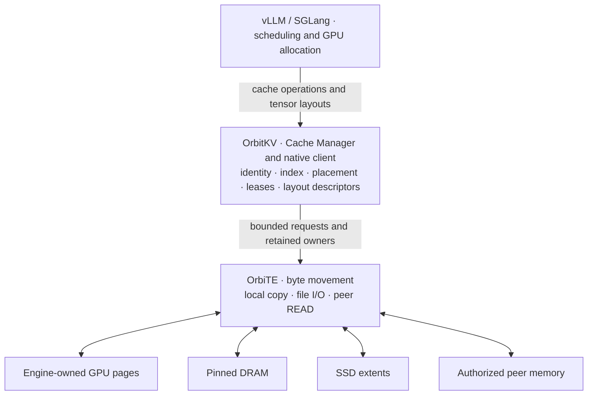

<p align="center">
  
</p>

<p align="center">
  <a href="https://orbitinfra.github.io/OrbitKV/">Website</a> ·
  <a href="https://orbitinfra.github.io/OrbitKV/docs/">Documentation</a> ·
  <a href="docs/single-node.md">Quickstart</a> ·
  <a href="docs/compatibility.md">Compatibility</a> ·
  <a href="docs/contributing.md">Contributing</a>
</p>

<p align="center">
  <a href="https://github.com/OrbitInfra/OrbitKV/actions/workflows/ci.yml"></a>
  <a href="docs/releases.md"></a>
  <a href="LICENSE"></a>
</p>

## About

**OrbitKV extends the KV cache of vLLM and SGLang beyond GPU memory.** It is for
serving workloads that reuse documents, system prompts and conversation prefixes.
An independent Cache Manager keeps reusable state in DRAM and optional SSD
across engine restarts; inference engines keep scheduling and GPU allocation.

Rust owns cache identity, placement, leases and bounded admission.
**OrbiTE is the only byte-transfer engine** for local GPU↔DRAM copies, SSD and
peer reads. Current GPU, RDMA, GDS and installed profiles are **unqualified**;
CPU/TCP and io_uring controls are CI evidence. Historical TENT results do not
qualify OrbiTE. See [support status](docs/compatibility.md) and [evidence](docs/performance.md).

## Key features

- **Reuse beyond GPU memory:** retain compatible prefixes in DRAM and optional
  SSD while the Manager stays alive. SSD is not durable across Manager restarts.
- **Share cache capacity:** attach local engines to a Manager or discover peer
  replicas through bounded inventory indexes and authoritative source grants.
- **Keep ownership explicit:** hold sources, destinations and registrations until
  physical completion; a timeout is never permission to reuse their bytes.
- **Describe recovery requirements:** compile supported prefix, window and
  checkpoint layouts into complete recovery boundaries. Engine guards still apply.

[Features and limits](docs/features.md) cover optional codecs and retention
policies. Live prefill/decode uses the [inference engine's native transport](docs/pd.md).

## Architecture



Implemented ownership boundaries; hardware paths remain **unqualified**.
See [architecture](docs/architecture.md) and [transfer contracts](docs/transport.md).

## Getting started

[OrbitKV 0.1.0 is unreleased](docs/releases.md). On Linux with a compatible
[CUDA 13 build/runtime environment](docs/releases.md#packages), build a complete
wheel from the repository root and install it into your chosen engine environment:

```bash
PYO3_PYTHON=python3.11 ./scripts/build-wheel.sh --release
uv pip install --python /path/to/engine-env/bin/python /absolute/path/to/the-built-wheel.whl
```

Use separate environments for the pinned engines and the same wheel for client
and Manager. The [quickstart](docs/single-node.md) supplies prerequisites, engine
installation and hit checks. With the chosen environment activated, start a Manager:

```bash
orbitkv-cache-manager --addr 127.0.0.1:50055 --http-addr 127.0.0.1:9091 --pool-size 8gb
```

Then choose one engine in another terminal with the same environment activated.
These are **unqualified hardware recipes**, not benchmark results.

**vLLM** ([pinned release and limits](docs/compatibility.md#official-engine-releases)):

```bash
VLLM_USE_V2_MODEL_RUNNER=0 vllm serve /path/to/immutable-model \
  --enforce-eager --enable-prefix-caching \
  --kv-transfer-config '{"kv_connector":"OrbitKVConnector","kv_role":"kv_both","kv_connector_module_path":"orbitkv.vllm"}'
```

**SGLang** ([pinned release and limits](docs/compatibility.md#official-engine-releases)):

```bash
ORBITKV_SGLANG_ENDPOINT=unix:///tmp/orbitkv-50055.sock \
  sglang serve --model-path /path/to/immutable-model --page-size 64 \
  --cuda-graph-backend-decode disabled --cuda-graph-backend-prefill disabled \
  --enable-unified-cache-external-linker --radix-cache-backend orbitkv
```

[Verify an external hit](docs/single-node.md#check-behavior-and-capacity): save a
multi-block prompt, keep the Manager alive, restart the engine and repeat it.
Check that `orbitkv_load_bytes_total` increases; a same-process repeat can hit
only native GPU cache. [Manager options](docs/server.md) explain the example budgets.

## Documentation

| Area | Start here |
| --- | --- |
| Getting started | [Overview](docs/goals.md), [installation and quickstarts](docs/single-node.md) |
| Supported engines and models | [Support matrix](docs/compatibility.md), [model recipes](docs/models.md) |
| Configuration | [Manager](docs/server.md), [engine adapters](docs/adapters.md) |
| Storage tiers | [DRAM retention](docs/cache-policies.md), [SSD/io_uring and GDS](docs/gds.md), [formats and compression](docs/storage-formats.md) |
| Distributed KV cache | [P2P deployment](docs/p2p.md), [peer control](docs/distributed-cache.md#application-and-transport-boundary) |
| Disaggregated prefill | [Native P/D composition](docs/pd.md) |
| Production | [Deployment](docs/deployment.md), [observability](docs/metrics.md), [fault behavior](docs/fault-qualification.md), [releases](docs/releases.md) |
| Benchmarks | [Methodology and evidence](docs/performance.md) |
| Developer guide | [Architecture](docs/architecture.md), [contributing](docs/contributing.md), [completion plan](docs/completion-plan.md) |

## Supported engines and models

The [pinned engine matrix](docs/compatibility.md#official-engine-releases) selects
**vLLM 0.31.0** (V1, one attention group) and **SGLang 0.5.22** (Full/SWA external
linker). Recurrent external recovery remains rejected. Start with the dense
[Qwen3-8B recipe](docs/models.md); broader layouts have separate limits.
**All current OrbiTE GPU and installed profiles remain unqualified.** Prior TENT
measurements retain their original revisions and do not establish current support.

## Updates

- **2026-11-07:** [OrbiTE becomes the sole transfer engine](https://github.com/OrbitInfra/OrbitKV/pull/326); hardware re-qualification remains open.

## Contributing

Follow the [contributor guide](docs/contributing.md) and the
[completion plan](docs/completion-plan.md). For the data flow, read
[transport](docs/transport.md) → [engine-local restore](docs/engine-local-restore.md)
→ [distributed cache](docs/distributed-cache.md) → [adapter contracts](docs/adapters.md).

## License

[Apache 2.0](LICENSE). Bundled dependencies retain their own licenses and notices.
