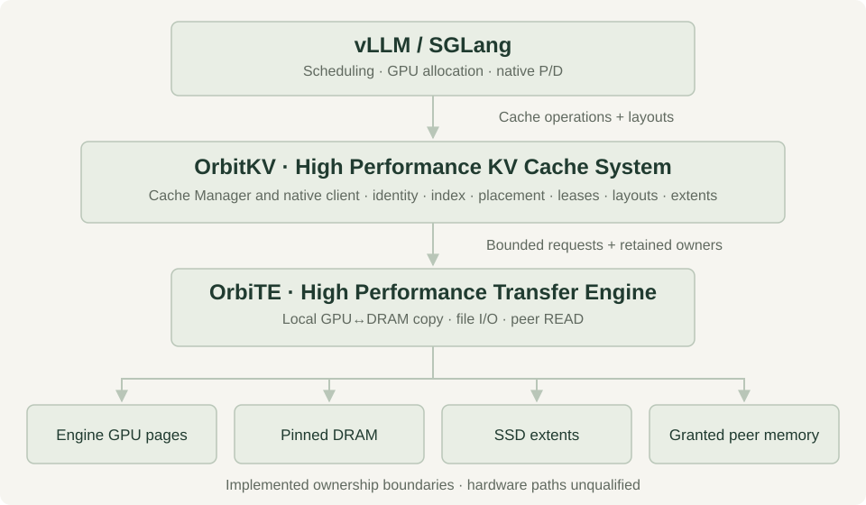

<p align="center">
  <picture>
    <source media="(prefers-color-scheme: dark)" srcset="docs/_static/logo-dark.svg" />
    
  </picture>
</p>

<p align="center"><strong>OrbitKV is a High Performance KV Cache System for LLM Inference.</strong></p>

<p align="center">
  <a href="https://orbitinfra.github.io/OrbitKV/">Documentation</a> |
  <a href="docs/single-node.md">Quickstart</a> |
  <a href="docs/completion-plan.md">Plan</a> |
  <a href="docs/contributing.md">Contributing</a>
</p>

<p align="center">
  <a href="https://github.com/OrbitInfra/OrbitKV/actions/workflows/ci.yml"></a>
  <a href="docs/releases.md"></a>
  <a href="LICENSE"></a>
</p>

OrbitKV keeps reusable KV for prefixes, documents and conversations beyond GPU memory,
in DRAM, local SSD and peer hosts, for vLLM and SGLang. A Rust Cache Manager owns
identity, placement and leases. [OrbiTE](https://github.com/OrbitInfra/OrbiTE) is the
high-performance transfer engine for local cache copies, storage I/O and peer reads.
Managers can share an SSD root and [release an offline partition's capacity](docs/storage-persistence.md#reclaim-an-offline-partition).

<picture>
  <source media="(prefers-color-scheme: dark)" srcset="docs/_static/architecture-dark.svg" />
  
</picture>

## Quick start

Use a separate environment for each engine; see [prerequisites and hit checks](docs/single-node.md).
Build and install the wheel, then start the Manager in the chosen environment:

```bash
PYO3_PYTHON=python3.11 ./scripts/build-wheel.sh --release
uv pip install --python /path/to/engine-env/bin/python /absolute/path/to/the-built-wheel.whl
orbitkv-cache-manager --addr 127.0.0.1:50055 --http-addr 127.0.0.1:9091 --pool-size 8gb
```

In another terminal with that environment activated, choose **vLLM**:

```bash
VLLM_USE_V2_MODEL_RUNNER=0 vllm serve /path/to/immutable-model \
  --enforce-eager --enable-prefix-caching \
  --kv-transfer-config '{"kv_connector":"OrbitKVConnector","kv_role":"kv_both","kv_connector_module_path":"orbitkv.vllm"}'
```

Or **SGLang**:

```bash
ORBITKV_SGLANG_ENDPOINT=unix:///tmp/orbitkv-50055.sock \
  sglang serve --model-path /path/to/immutable-model --page-size 64 \
  --cuda-graph-backend-decode disabled --cuda-graph-backend-prefill disabled \
  --enable-unified-cache-external-linker --radix-cache-backend orbitkv
```

**Status:** unreleased; engine baselines are vLLM 0.33.0 / SGLang 0.5.23. See [compatibility and limits](docs/compatibility.md).
GPU, RDMA and GDS are unqualified on the current OrbiTE path; CPU/TCP and io_uring are CI evidence.

[Contributing](docs/contributing.md) · [Apache 2.0 license](LICENSE).
