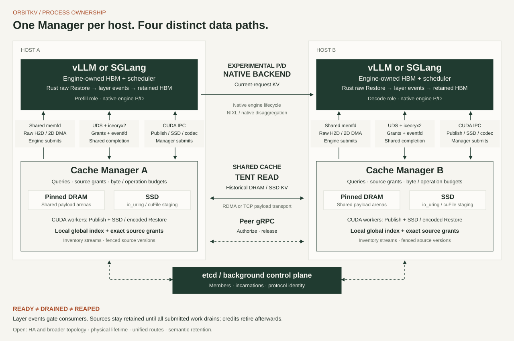
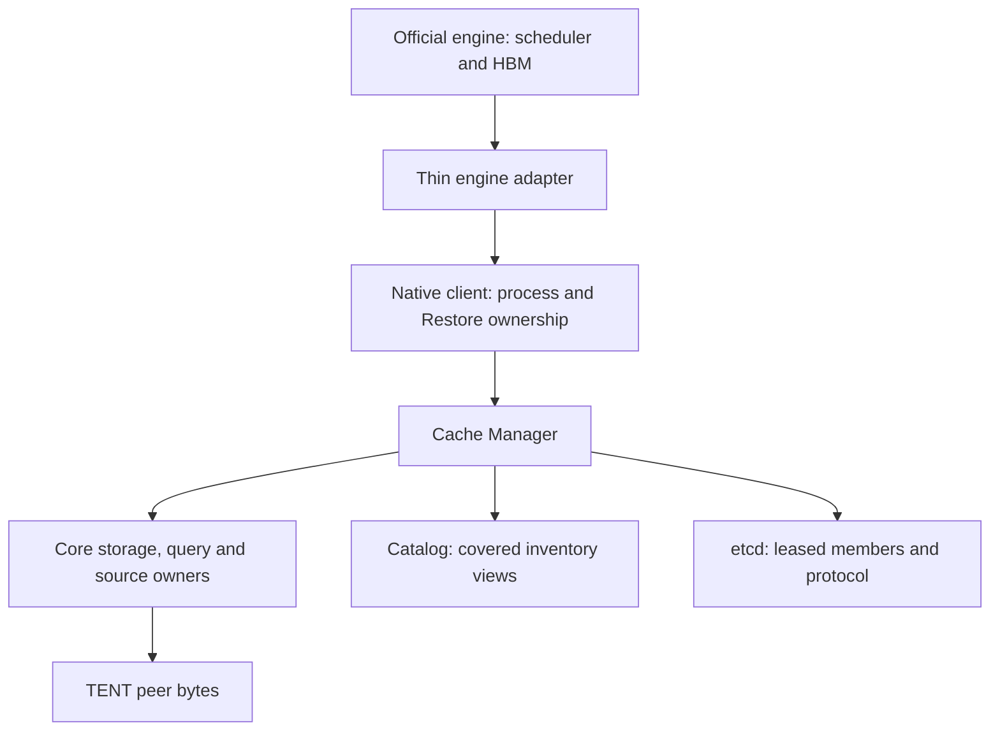

# OrbitKV architecture

## Mission

Extend engine KV capacity with reusable DRAM, SSD and peer replicas. Engines
retain scheduling and GPU allocation; Rust owns external cache state and resource
lifetime. Start with [compatibility](compatibility.md) and [deployment](deployment.md).
Architecture contracts are not completion claims; the [completion plan](completion-plan.md)
is the only execution queue.

## Process topology

Run one independent Cache Manager per inference host. An engine adapter connects
through authenticated UDS bootstrap/lifecycle and versioned iceoryx2 commands.
Shared payload arenas support engine-local raw DRAM Restore. Publish and SSD/codec
Restore remain in Manager CUDA workers with registered engine-owned destinations.
Standalone operation needs neither etcd nor a peer gRPC listener.

| Path | Control/ownership | Payload |
| --- | --- | --- |
| Local raw DRAM Restore | Native client keeps destination/source holds and readiness dependencies | Engine-local DMA or selected copy kernel |
| Publish and SSD/codec Restore | Manager workers retain accepted-operation resources | CUDA IPC plus storage/codec execution |
| Peer cached state | Local candidates, authoritative source grant and completion reconciliation | TENT READ into consumer-owned staging, then ordinary restoration |
| Current-request P/D | Official engine lifecycle/backend; independent cache adapter | vLLM NIXL/MultiConnector or SGLang native disaggregation |

In distributed mode etcd maintains protocol identity and leased members. Bounded
scoped owner inventory streams install local candidate views with explicit coverage.
Queries use those views rather than per-key etcd RPCs. Grants revalidate source
incarnation, representation and allocation generation. See [distributed design](distributed-design.md).

## API and crate boundaries

| Owner | Responsibility |
| --- | --- |
| `orbitkv-state` | Model/computation/storage identity and compiled recovery requirements |
| `orbitkv-channel` | Native client, process protocol, query tickets and accepted-operation lifetime |
| `orbitkv-core` | Storage/leases, query budgets, source plans, transfers and codecs |
| `orbitkv-server` | Manager endpoints, cluster membership/inventory and peer protocol |
| `orbitkv-catalog` | Covered local indexes and cached member admission |
| `orbitkv-transfer` / `orbitkv-mooncake-sys` | TENT ownership, terminal batches and pinned native ABI |
| Python adapters | Engine callbacks, layout inspection, allocation and GPU handoff |

Use the behavior owner directly. Avoid a Python coordinator, second catalog,
forwarding facade or speculative generic transport layer. Native bindings remain
thin; [contributing](contributing.md) maps implementation and test locations.

## Definitions and naming

**Identity** describes compatible semantic state and bytes. **Generation** describes
a particular owned allocation/incarnation. Matching semantic keys do not make
stale allocations reusable. **Coverage** describes what a local index actually
knows; missing coverage is not a proven cache miss.

**Ready** permits a declared consumer boundary to run. **Drained** proves all
submitted physical users ended. **Reaped** records actual child-process collection.
These are separate facts. Cancellation, timeout, lease expiry or a control ACK
cannot substitute for physical CUDA/RDMA/SSD termination.

A **recovery requirement** declares pages/windows/checkpoints needed at a legal
boundary. A **source plan** acquires concrete replica evidence and leases. The
future general physical planner must consume the same ownership decision, rather
than add an observation-only parallel policy.

## Core module ownership

| Module | Concrete resources/behavior |
| --- | --- |
| `engine/` | Registration, query, Publish and Restore orchestration |
| `memory/` | NUMA placement, allocations and pools |
| `storage/` | Residency assembly, DRAM/SSD owners and pinned-memory reclamation |
| `query/` | Admission, shared reads, query leases and completion handoff |
| `peer/` | Source grants/exports, remote READ and completion reconciliation |
| `transfer/` | GPU layouts, bounded copy plans, workers and final ownership fences |
| `codec/` | Encoding metadata, GPU batches/workspace and CPU fallback |
| `planning/` / `cost/` | Candidate/target contracts, eligible routes and bounded observations |

Keep allocation, lease and physical-drain proof with these existing owners.
Detailed contracts live in [transport](transport.md), [engine-local Restore](engine-local-restore.md),
[peer control](peer-control.md), [GPU storage](gds.md) and [storage formats](storage-formats.md).

## Upstream designs and OrbitKV owners

[LMCache](https://github.com/LMCache/LMCache) guides user documentation and released
engine entry points. [FlexKV's integration](adapters.md#lmcache-and-flexkv-reference)
provides a transfer reference. Mooncake TENT supplies Manager data transfer;
its RPC or metadata format does not own OrbitKV's cache semantics.

The [Mooncake RFC #3504](https://github.com/kvcache-ai/Mooncake/issues/3504) is a
proposal reference, not implementation equivalence or OrbitKV qualification.
See [the integration comparison](adapters.md#lmcache-and-flexkv-reference) and
[distributed comparison](distributed-comparison.md) for pinned mechanisms/limits.

## Layering

The current layers execute recovery validation and bounded concrete routes.
A general semantic retention compiler and unified route optimizer remain future
work; no diagram arrow claims those policies are complete.

### `orbitkv-state`

Versioned identity and explicit recovery rules compile declared attention,
window and checkpoint demands. Leased evidence must cover every required range
at a legal boundary. This does not analyze arbitrary model graphs or predict
future tokens. See [state identity](state-identity.md) and [hybrid recovery](hybrid-recovery.md).

### Framework adapters

vLLM uses the official KV Connector scheduler/worker callbacks; its current
qualified cache profile uses V1 and one attention group. SGLang uses the official
UnifiedRadixCache external linker and remaining version-coupled safety hooks.
Python retains engine allocation/events and Rust owns shared cache state/waits.
No custom P/D connector, handshake proxy or maintained fork runtime is required.
See [adapter contracts](adapters.md).

### `orbitkv-core`

Core owns external representations, byte budgets, source/destination lifetime,
query execution and storage. A granted source is held until authoritative drain,
even if the caller times out or drops its Python handle. Storage policy cannot
release a physically active allocation.

### Transfer and backing domains

Raw DRAM Restore executes in the engine through independently registered shared
arenas. SSD/codec paths use Manager workers and bounded staging. Peer SSD uses
exact-generation source-side staging before the same TENT READ contract. Per-layer
readiness, multipart partitioning and whole-operation drain retain distinct owners.
Native GDS and broad transport-fault qualification remain open.

## SGLang integration

### Direct GPU linker and compiled recovery

The linker saves page-aligned engine state and restores validated demanded ranges
into SGLang-owned slots. Pending reads preserve admission/expiry/cancel ownership;
recompute remains possible within the declared deadline. SGLang still owns radix
structure, scheduler and HBM allocation. Synthetic combined-layout byte controls
are separate from complete released hybrid model recovery.

### P/D handoff

Official native disaggregation owns real-time handoff. Independent OrbitKV cache
currently restores/saves on P and saves only on D in the composition candidate,
so native incoming pages have one writer. Manager-to-Manager cache bytes continue
through TENT regardless of the engine's live P/D transport. Partial submission,
late ACK, cancellation and page reuse require the [native P/D fault gates](pd.md).

### Future: Radix lifecycle bridge for routing

A public consumed lifecycle callback may expose invalidation/eviction events to
planning. Until that interface exists, remaining private safety hooks are explicit
release dependencies; deleting them does not complete the migration.

### Future: generation-safe page references

Engine-authored page generations must be consumed in registration, grants,
destination use and reuse decisions. Semantic non-use alone cannot release pages
still referenced by CUDA, storage or RDMA. This is S3-dependent work.

## Safety invariant

A source allocation and destination remain owned until all accepted physical
operations terminate. Readiness may allow a consumer to proceed earlier only
when its actual CUDA/layer boundary consumes the dependency. Byte credits,
semantic references and physical memory holds are distinct.

Unknown drain retains/quarantines memory with bounded diagnostics. Process
shutdown records leader status, group state, forced cleanup and actual waits;
a zero API-leader exit is not every-child or GPU/RDMA drain proof. Source crash,
permanent requester loss and allocation reuse require explicit termination evidence.

## Multi-node cache path and deployment

1. Member leases establish current cluster identity/incarnation.
2. Bounded owner streams atomically install covered local inventory views.
3. Query planning selects compatible candidates under byte budgets.
4. The source grants an exact owned allocation; TENT READ moves the bytes.
5. The consumer restores into engine-owned slots and reconciles final release.

Loss of coverage or retired membership blocks stale remote authorization while
local recovery can continue. Scoped two-host ordinary RDMA serving does not
qualify independent fault domains, cache HA or safe crash reclamation. See
[P2P deployment](p2p.md), [shared-cache gates](shared-cache-qualification.md) and
[the S2 envelope](completion-plan.md#s2--metadata-reliability-and-measured-capacity).

## Planning direction

Bounded cost observations, raw-copy/SSD shadow estimates and guarded matching
peer selection are implemented. A unified consumed planner remains open. It must
compare equal recovery coverage and completion targets, acquire real leases,
credits and destinations, include complete cost once and replan safely on stale
evidence. Unknown cost is not zero; submitted payload failure is not permission
for blind cross-medium retry.

Receiver admission/fairness must account for physical NIC/device budgets and
engine-owned native P/D traffic as well as Manager cache READs. Routing requests
is separate from choosing a recovery route. General read-set/retention IR,
checkpoint placement and semantic reclaim remain S7 work. See [planning contracts](state-planning.md).

## Ownership boundary by milestone

S2 owns metadata/coverage reliability; S3 owns generations and physical termination;
S4 optimizes measured execution; S5 consumes released engine contracts; S6 owns
executed route/admission planning; S7 owns semantic retention; S8 owns final product
artifacts and publication. [The completion plan](completion-plan.md) records status,
dependencies and acceptance. The [immutable architecture snapshot](https://github.com/OrbitInfra/OrbitKV/blob/251f463d8997eff783871ab2820da83a13a97196/docs/architecture.md)
retains earlier detailed comparisons and design history.
