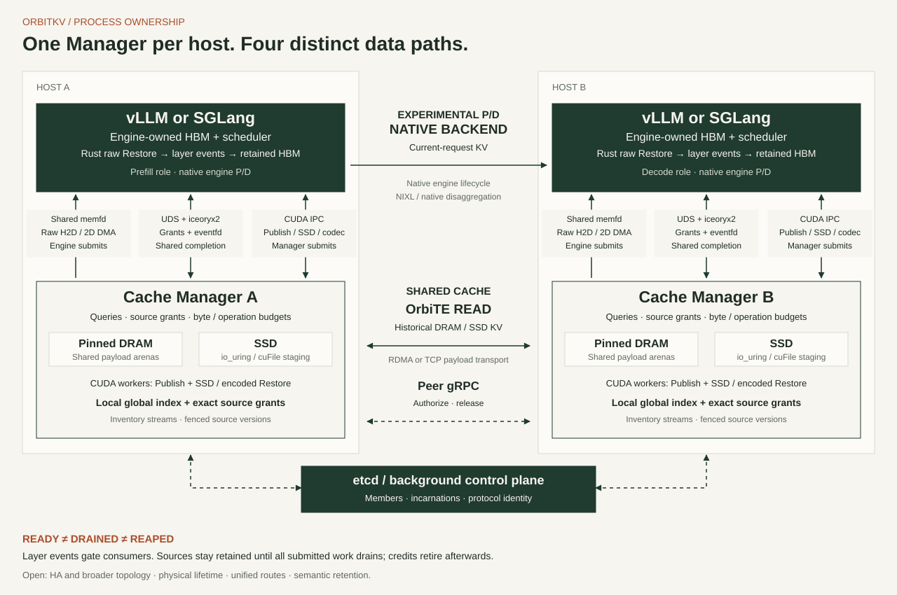
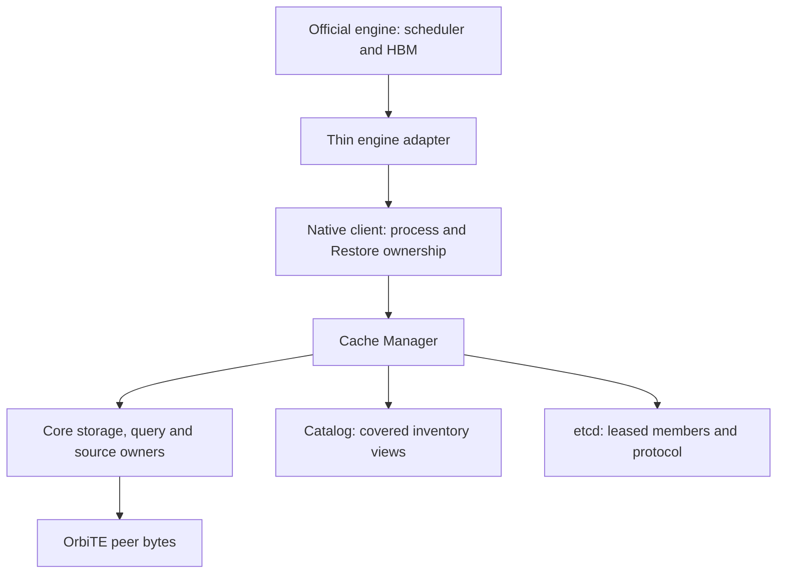

# OrbitKV architecture

## Mission

Extend engine KV capacity with reusable DRAM, SSD and peer replicas. Engines
retain scheduling and GPU allocation; Rust owns external cache state and resource
lifetime. Start with [compatibility](compatibility.md) and [deployment](deployment.md).
Architecture contracts are not completion claims; the [completion plan](completion-plan.md)
is the only execution queue.

## Process topology

Run one independent Cache Manager per inference host. An engine adapter connects
through authenticated UDS bootstrap/lifecycle and versioned iceoryx2 commands.
Shared payload arenas support engine-local raw DRAM Restore. Publish and SSD/codec
Restore remain in Manager CUDA workers with registered engine-owned destinations.
Standalone operation needs neither etcd nor a peer gRPC listener.

| Path | Control/ownership | Payload |
| --- | --- | --- |
| Local raw DRAM Restore | Native client keeps destination/source holds and readiness dependencies | OrbiTE local copies and completion |
| Publish and SSD/codec Restore | Manager workers retain accepted-operation resources | OrbiTE local/file transfers; GPU codec compute |
| Peer cached state | Local candidates, authoritative source grant and completion reconciliation | OrbiTE READ into GPU Restore pages, or DRAM for cache-tier fills |
| Current-request P/D | Official engine lifecycle/backend; independent cache adapter | vLLM NIXL/MultiConnector or SGLang native disaggregation |

In distributed mode etcd maintains protocol identity and leased members. Bounded
scoped owner inventory streams install local candidate views with explicit coverage.
Queries use those views rather than per-key etcd RPCs. Grants revalidate source
incarnation, representation and allocation generation. See [distributed design](distributed-cache.md).

## API and crate boundaries

| Owner | Responsibility |
| --- | --- |
| `orbitkv-state` | Model/computation/storage identity and compiled recovery requirements |
| `orbitkv-channel` | Native client, process protocol, query tickets and accepted-operation lifetime |
| `orbitkv-core` | Storage/leases, query budgets, source plans, transfers and codecs |
| `orbitkv-server` | Manager endpoints, cluster membership/inventory and peer protocol |
| `orbitkv-catalog` | Covered local indexes and cached member admission |
| `transfer_engine/` and `peer/orbite.rs` | OrbiTE registrations, requests and physical drain |
| Python adapters | Engine callbacks, layout inspection, allocation and GPU handoff |

Use the behavior owner directly. Avoid a Python coordinator, second catalog,
forwarding facade or speculative generic transport layer. Native bindings remain
thin; [contributing](contributing.md) maps implementation and test locations.

## Definitions and naming

**Identity** describes compatible semantic state and bytes. **Generation** describes
a particular owned allocation/incarnation. Matching semantic keys do not make
stale allocations reusable. **Coverage** describes what a local index actually
knows; missing coverage is not a proven cache miss.

**Ready** permits a declared consumer boundary to run. **Drained** proves all
submitted physical users ended. **Reaped** records actual child-process collection.
These are separate facts. Cancellation, timeout, lease expiry or a control ACK
cannot substitute for physical CUDA/RDMA/SSD termination.

A **recovery requirement** declares pages/windows/checkpoints needed at a legal
boundary. A **source plan** acquires concrete replica evidence and leases. Plans must acquire the matching ownership before execution.

## Core module ownership

| Module | Concrete resources/behavior |
| --- | --- |
| `engine/` | Registration, query, Publish and Restore orchestration |
| `memory/` | NUMA placement, allocations and pools |
| `storage/` | Residency assembly, DRAM/SSD owners and pinned-memory reclamation |
| `query/` | Admission, shared reads, query leases and completion handoff |
| `peer/` | Source grants/exports, remote READ and completion reconciliation |
| `transfer/` | GPU layouts, bounded copy plans, workers and final ownership fences |
| `codec/` | Encoding metadata, GPU batches/workspace and CPU fallback |
| `planning/` / `cost/` | Candidate/target contracts, eligible routes and bounded observations |

Keep allocation, lease and physical-drain proof with these existing owners.
Detailed contracts live in [transport](transport.md), [engine-local Restore](engine-local-restore.md),
[peer control](distributed-cache.md#application-and-transport-boundary), [GPU storage](gds.md) and [storage formats](storage-formats.md).

## Layering

The current layers validate declared recovery requirements and execute bounded
local, file and peer routes. Planned product work lives only in the completion plan.

### `orbitkv-state`

Versioned identity and explicit recovery rules compile declared attention,
window and checkpoint demands. Leased evidence must cover every required range
at a legal boundary. This does not analyze arbitrary model graphs or predict
future tokens. See [state identity](state-identity.md) and [hybrid recovery](hybrid-recovery.md).

### Framework adapters

vLLM uses the official KV Connector scheduler/worker callbacks; its current
cache configuration requires V1 and one attention group. SGLang uses the official
UnifiedRadixCache external linker and remaining version-coupled safety hooks.
Python retains engine allocation/events and Rust owns shared cache state/waits.
No custom P/D connector, handshake proxy or maintained fork runtime is required.
See [adapter contracts](adapters.md).

### `orbitkv-core`

Core owns external representations, byte budgets, source/destination lifetime,
query execution and storage. A granted source is held until authoritative drain,
even if the caller times out or drops its Python handle. Storage policy cannot
release a physically active allocation.

### Transfer and backing domains

Raw DRAM Restore executes in the engine through independently registered shared
arenas. Peer restore submits remote→GPU through OrbiTE;
only DRAM cache-tier fills retain a host destination. The imported tensor owner
and client completion remain retained on unknown drain. Encoded peer inputs go
to GPU codec allocations. SSD/codec layouts use Manager workers.
`TransferEngine` moves file bytes through io_uring or opt-in GDS; OrbitKV keeps
extent leases and metadata publication. OrbiTE consumes layout vectors with
padding directly into GPU pages or persistent codec inputs; its engine owns
storage gather/scatter and staging. Unknown drain
retains backing, the immutable/unpublished extent and the file-operation budget.
See [SSD file transfers](transport.md#ssd-file-transfers). Peer SSD uses
exact-generation source-side staging before the same OrbiTE READ contract. Per-layer
readiness, multipart partitioning and whole-operation drain retain distinct owners.
Native GDS and broad transport-fault qualification remain open.

## SGLang integration

### Direct GPU linker and compiled recovery

The linker saves page-aligned engine state and restores validated demanded ranges
into SGLang-owned slots. Pending reads preserve admission/expiry/cancel ownership;
recompute remains possible within the declared deadline. SGLang still owns radix
structure, scheduler and HBM allocation. Synthetic combined-layout byte controls
are separate from complete released hybrid model recovery.

### P/D handoff

Official native disaggregation owns real-time handoff. Independent OrbitKV cache
currently restores/saves on P and saves only on D in the composition candidate,
so native incoming pages have one writer. Manager-to-Manager cache bytes continue
through OrbiTE regardless of the engine's live P/D transport. Partial submission,
late ACK, cancellation and page reuse require the [native P/D fault gates](pd.md).

## Safety invariant

A source allocation and destination remain owned until all accepted physical
operations terminate. Readiness may allow a consumer to proceed earlier only
when its actual CUDA/layer boundary consumes the dependency. Byte credits,
semantic references and physical memory holds are distinct.

Unknown drain retains/quarantines memory with bounded diagnostics. Process
shutdown records leader status, group state, forced cleanup and actual waits;
a zero API-leader exit is not every-child or GPU/RDMA drain proof. Source crash,
permanent requester loss and allocation reuse require explicit termination evidence.

## Multi-node cache path and deployment

1. Member leases establish current cluster identity/incarnation.
2. Bounded owner streams atomically install covered local inventory views.
3. Query planning selects compatible candidates under byte budgets.
4. The source grants an exact owned allocation; OrbiTE READ moves the bytes.
5. The consumer restores into engine-owned slots and reconciles final release.

Loss of coverage or retired membership blocks stale remote authorization while
local recovery can continue. Historical scoped two-host RDMA serving does not
qualify independent fault domains, cache HA or safe crash reclamation. See
[P2P deployment](p2p.md), [shared-cache gates](fault-qualification.md#shared-cache-gates) and
[metadata qualification](completion-plan.md#milestones).

## Planning and cost observations

`planning/` selects compatible candidates and completion targets; `cost/` keeps
bounded observations. Neither changes cache identity, grants or physical drain.
Unknown cost is not zero. Submitted payload failure never permits blind replay
through a different medium. A route acquires actual source leases, byte credits
and destinations before execution.

The observer holds at most 512 entries, requires four successful samples and
expires after five idle minutes. Keys include resource/incarnation, representation,
size/fragment class and destination shape. Contention drops an update rather than
blocking execution. Failures and cancelled/timed-out work do not train successes.
Physical bytes are counted once by their owner; parent restore totals overlap
copy/file/codec legs and must not be summed. `nic_load_stats` supplies OrbiTE RDMA
load; missing route timing remains unknown.

`ORBITKV_COST_OBSERVATIONS=1` enables observation/shadow estimates;
`ORBITKV_COST_SELECTION=1` additionally enables guarded equal-coverage same-medium
peer selection. `ORBITKV_CROSS_MEDIUM_SELECTION=1` is experimental and requires
fresh compatible HostReady evidence. All are off by default. Shadow comparisons
require matching work/resources and a margin exceeding the estimates' errors;
they are not a statistical guarantee. The separate 128-entry resource cache
expires after two seconds. A prediction cannot create a lease or drain receipt.

See [metrics](metrics.md#bounded-cost-observations) for clocks and counters and
[performance](performance.md#qualification-limits) for failed observer guards.
The [completion plan](completion-plan.md) owns product work and qualification.
