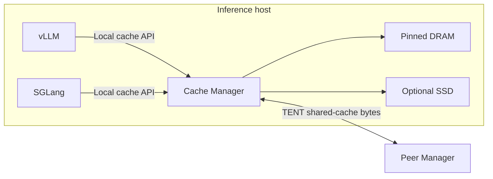

# Deployment

Run one independent Cache Manager per inference host. Engines on that host share
its DRAM/SSD capacity while retaining their own HBM allocation and scheduling.
Use [compatibility](compatibility.md) for the support matrix and the
[quickstart](single-node.md) for complete installation and ordinary-cache commands.

This follows the independent-service organization described by
[LMCache multiprocess deployment](https://github.com/LMCache/LMCache/blob/05a013b29da78cf2321b9b46ec5039dde2fb0bb0/docs/source/mp/deployment.rst).
Its support claims do not become OrbitKV support. Rust remains the cache/resource
owner; Python supplies engine callbacks, layout and GPU handoff.

## Choose a topology

Start with one dense TP=1/PP=1 engine and one Manager. Then select a separately
qualified profile: shared Manager, independent peer replicas or native P/D plus
cache. Dense H20 single-engine/shared-Manager recovery and scoped two-H20 RDMA
serving have acceptance; HA, physical multi-rank and container profiles remain open.



Matching model/computation/layout identity is required for reuse. Sharing one
service does not make different engines' KV bytes interchangeable.
Real-time P/D uses the native engine backend and a separate ownership contract.

## Configure capacity, then connect engines

Install the same complete OrbitKV build in the Manager and client environments.
Upgrade them together; mismatched protocol versions are rejected. The Manager
needs compatible PyTorch/CUDA but does not load the model.

```bash
orbitkv-cache-manager \
  --addr 127.0.0.1:50055 --http-addr 127.0.0.1:9091 --pool-size 8gb
```

To enable SSD, add `--ssd-cache-path /data/orbitkv/cache.bin` and
`--ssd-cache-capacity 100gb`. Set capacity explicitly; the omitted default is
`512gb`. The file is recreated at startup and is not persistent across Manager
restarts. Automatic selection tries cuFile and uses io_uring when unavailable;
no cuFile service or engine-side backend selection is needed. Explicit `uring`
and `cufile` overrides are for controlled diagnosis; cuFile initialization does
not prove native GDS. See [storage eligibility and routes](gds.md).

| Resource | Owner/configuration |
| --- | --- |
| HBM pages and active request memory | Each engine's allocator and scheduler |
| Shared pinned DRAM | Manager `--pool-size` |
| SSD capacity | Manager cache path/capacity |
| Pending and leased query bytes | Manager `--query-budget`, `--query-instance-budget` |

Payload arenas use shared memfds and independent CUDA host registration. The
Manager binds payload placement to the GPU-local NUMA node before first-touch;
rejected `mbind` or disallowed memory nodes fail explicitly. CPU affinity alone
is not placement evidence. Huge pages require reserved hugetlb resources and
permissions; no silent regular-page fallback is promised.

Keep optional warming, retention and cost-selection experiments off until the
matching workload qualifies. `ORBITKV_COST_SELECTION=1` requires observations
and only selects comparable candidates; it is not a general cross-tier optimizer.
See [planning contracts](state-planning.md#policies-by-deployment-mode).

## Share one Manager

Each engine registers its own instance and destinations. Connect them to the
same local socket and use different serving ports:

| Engine | Local endpoint |
| --- | --- |
| vLLM | Default `/tmp/orbitkv-50055.sock`; override `orbitkv.bootstrap_socket` in `kv_connector_extra_config` |
| SGLang | `ORBITKV_SGLANG_ENDPOINT=unix:///tmp/orbitkv-50055.sock` |

The H20 900-second two-engine direct/kernel io_uring pressure gate accepts
correctness, progress and bounded reservations for its frozen dense eager
configuration. It does not establish fairness, tail isolation, Manager restart
or separate-container support. Validate each engine's recovery against its own
native controls; see [adapter contracts](adapters.md).

## H20 direct CUDA runtime

One reviewed container profile needed a private empty `CUDA_MPS_PIPE_DIRECTORY`
to avoid an inherited MPS-path initialization timeout. This is a recorded runtime
diagnosis, not a general instruction to change host drivers or bypass GPU access.
Validate actual CUDA compute and IPC in the selected process environment before
launching. See the [immutable runtime evidence](https://github.com/OrbitInfra/OrbitKV/blob/251f463d8997eff783871ab2820da83a13a97196/docs/deployment.md#h20-direct-cuda-runtime).

## Containers and Kubernetes

Manager and engines require the same host, compatible UID credentials, accessible
bootstrap socket, iceoryx2 discovery/shared-memory resources and GPU devices.
Native lifecycle checks also require process visibility. A remote HTTP endpoint
cannot replace the local process channel. Separate PID namespaces and independent
container manifests remain unqualified.

GPU registration uses the full device UUID. Numeric, UUID, reordered and partial
`CUDA_VISIBLE_DEVICES` views may resolve different ordinals for the same GPU;
do not require ordinal equality. Verify effective allowed NUMA nodes and `mbind`
permissions as well as CPU affinity. Peer RDMA needs selected NIC/provider
libraries and physical network visibility. Native GDS additionally needs its
supported driver, device/filesystem stack and cuFile; optional compatibility
fallback is not GPU-direct storage evidence.

Keep sockets, mappings, registrations and accepted operations owned through
normal shutdown. Report forced cleanup separately. An API leader's zero exit does
not by itself prove every child was reaped or all physical GPU/RDMA work drained.

## Add peer caching

Configure per-host Managers with matching cluster identity, unique node IDs and
real etcd endpoints; follow [P2P deployment](p2p.md). etcd stores protocol identity
and leased membership. Bounded scoped inventory streams feed local candidate
indexes; authoritative source grants fence incarnation/generation before TENT
moves DRAM or source-side SSD-staged bytes. No per-key etcd lookup is required.

Scoped two-H20 official-engine dense RDMA recovery and controlled restarts pass.
Cache HA, permanent requester loss, independent etcd failure domains and broad
parallelism need distinct fault evidence. Three etcd processes do not establish
three independent power/network domains. See [shared-cache qualification](shared-cache-qualification.md)
and the [S2 gates](completion-plan.md#s2--metadata-reliability-and-measured-capacity).

## P/D: Mooncake or NIXL

Official vLLM uses native NIXL/MultiConnector. Official SGLang uses its native
disaggregation backend/router. OrbitKV supplies independent cache adapters;
Manager peer-cache traffic stays on TENT. Custom OrbitKV P/D connectors, handshake
proxy and fork-only factories remain retired.

### Experimental vLLM P/D with NIXL plus OrbitKV cache

The current candidate gives P read/write cache and D save-only cache, so incoming
native P/D and cache restore do not compete for the same D pages. Follow the
[maintained native P/D recipe](pd.md); ordinary cache success does not qualify
transfer cancellation, partial submission, delayed ACK or page reuse.

### Prefill

Let native P/D own the request lifecycle and outgoing handoff. Independently
restore compatible cached prefixes and save computed reusable state through the
ordinary adapter. Freeze engine version, model, roles and cache selection order.

### Decode

Let the native backend own incoming destinations. Save-only cache is the current
candidate; opening cache restore on D requires separate single-writer and lifetime
gates. Python does not replace native transfer ownership with a coordinator.

### Validate D-to-P reuse

Keep the Manager alive across the relevant engine restart, compare output with a
monolithic control and verify actual cache restore bytes. Qualify cancellation,
preemption, peer loss, partial submit, late ACK and page reuse before broadening
support. Native model output is not physical drain proof. Detailed historical
commands remain in the [immutable deployment snapshot](https://github.com/OrbitInfra/OrbitKV/blob/251f463d8997eff783871ab2820da83a13a97196/docs/deployment.md).
