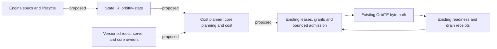

# OrbitKV design v2: state compiler, versioned trees and attention-guided paging

**Design and experiment plan only. No implementation or qualification claim.**
Source audit: 2026-11-08; OrbitKV `87991239`, OrbiTE `f0556448`, vLLM 0.31.0,
SGLang 0.5.22. The [completion plan](completion-plan.md) owns delivery order.
The [earlier hybrid proposal](hybrid-cache-design.md), reviewed in #328, remains
historical design context; this proposal broadens its experiment plan.
The next PR is a trace-driven simulator, subject to separate review.
All GPU, RDMA, GDS, installed-serving and rack-scale profiles remain unqualified.

The objective is a cache of recoverable inference state, optimized for modern
attention and branching agents. Engines describe and compute state; OrbitKV
compiles recovery and placement decisions; OrbiTE alone moves bytes. Database
ideas supply useful tools: dependency-aware materialization, immutable versions,
costed queries and safe reclamation. They are analogies, not novelty claims.

## 1. Verified workload and engine boundary

### Model evidence, not a support matrix

These official configurations/cards and papers describe different state graphs.
Ratios, precisions and context limits must not be generalized across variants.
None of these rows enables a model in OrbitKV.

| Model | Verified architecture and cache consequence | Primary evidence |
| --- | --- | --- |
| DeepSeek V4-Flash | CSA compresses sequence entries 4:1 before sparse selection; HCA compresses 128:1 and attends densely to compressed entries. SWA and incomplete compression tails need position-specific state. The serving system stores compressed prefix KV on disk and trades SWA storage against replay. Main KV is FP8; the indexer QK path uses MXFP4. | [V4 report, §§2.3, 3.5, 5.2.1](https://arxiv.org/html/2606.19348v1), [config](https://huggingface.co/deepseek-ai/DeepSeek-V4-Flash/blob/60d8d70770c6776ff598c94bb586a859a38244f1/config.json), [V4.1 precision comparison, §2.4.4](https://arxiv.org/html/2609.19969v1) |
| DeepSeek V4.1-Flash | A different schema: causal encoder/decoder, CSA2 cross-layer KV/index reuse, FP4 main KV with scales, FP8 SWA, and bounded replay to reconstruct SWA instead of persisting it. The config names shared source layers. Accounting and eviction must follow physical aliases, not multiply independent copies by layer count. | [Report, §§2.2–2.4, 3.2](https://arxiv.org/html/2609.19969v1), [card](https://huggingface.co/deepseek-ai/DeepSeek-V4.1-Flash/blob/314113f8a7dadb388215396ba5fbee2c610a04d6/README.md), [config](https://huggingface.co/deepseek-ai/DeepSeek-V4.1-Flash/blob/314113f8a7dadb388215396ba5fbee2c610a04d6/config.json) |
| Kimi K3 | 69 KDA and 24 Gated-MLA layers, approximately 3:1, with a 1,048,576-position configuration. Recurrent/conv snapshots coexist with MLA latent history. The MXFP4 weight configuration does not establish the cache dtype. | [Card](https://huggingface.co/moonshotai/Kimi-K3/blob/f831ab66814297da540d832a5235f8e904f29d06/README.md), [config](https://huggingface.co/moonshotai/Kimi-K3/blob/f831ab66814297da540d832a5235f8e904f29d06/config.json) |
| Qwen3.8-27B / Flash-Next | The dense model has 48 Gated DeltaNet and 16 attention layers. Flash-Next retains the 3:1 pattern but uses QSA with a compressed micro-block indexer in the attention layers. Both audited configs declare 262,144 positions; a hosted context offering is not this config. N-gram embedding weights are not KV. | [27B card](https://huggingface.co/Qwen/Qwen3.8-27B/blob/37561816e66b5b9153b1b64c10968c18c1e6f4a0/README.md), [27B config](https://huggingface.co/Qwen/Qwen3.8-27B/blob/37561816e66b5b9153b1b64c10968c18c1e6f4a0/config.json), [Next paper](https://arxiv.org/abs/2608.30320), [Next config](https://huggingface.co/Qwen/Qwen3.8-Flash-Next/blob/812d96e10a0dd82b69d749e68693698cf6c36daa/config.json) |
| GLM-5.3 / Flash | GLM-5.3 uses DSA with `index_topk=2048`; indexer reuse is explicit in its config. Flash combines linear and sparse attention and also declares top-2048 selection. Indexer state, pooled tails and recurrent state require separate lifetimes. | [5.3 config](https://huggingface.co/zai-org/GLM-5.3/blob/ba32f8c19c8738e2c57c71798c601d477a7bf844/config.json), [Flash card](https://huggingface.co/zai-org/GLM-5.3-Flash/blob/46a050bec13002ad29ee795c16e61cf4fa3c4a9c/README.md), [Flash config](https://huggingface.co/zai-org/GLM-5.3-Flash/blob/46a050bec13002ad29ee795c16e61cf4fa3c4a9c/config.json) |
| Gemma 4 | The 31B config repeats five SWA layers with a 1,024-token window, then one global layer. E2B instead repeats four SWA layers with a 512-token window, then global attention. Compile the actual variant. | [31B config](https://huggingface.co/google/gemma-4-31B-it/blob/842da3794eaa0b77d5f08bae87a17459d91ff475/config.json), [E2B config](https://huggingface.co/google/gemma-4-E2B-it/blob/4adf15748de9e1a0097b6274cee9c15836c41c37/config.json), [Google card](https://ai.google.dev/gemma/docs/core/model_card_4) |
| MiniMax M3 | Block-selection sparse attention over a full KV backing, not sequence-compressed KV. The config selects 16 blocks of 128 tokens, with a local block and early full-attention layers. Selection granularity and physical transfer granularity can differ. | [MSA paper](https://arxiv.org/abs/2606.13392), [config](https://huggingface.co/MiniMaxAI/MiniMax-M3/blob/d95e30cb912fe3021bb9c2ba66a8ce60b6c937a9/config.json) |

Model configs are schema evidence, not executable recovery contracts. They omit
some allocation layouts, runtime quantization choices and snapshot semantics.
FP4/MXFP4 weights do not imply FP4 recurrent state or KV. Packed values, scales,
RoPE portions, padding and convolution history all count toward actual bytes.
Compression tails require the engine's carry-state description, not merely
`token_count % compression_ratio` uncompressed K/V entries.

### What native engines already do

vLLM's September 2026 [tiered offload](https://vllm.ai/blog/2026-09-10-tiered-kv-offloading)
already supports SWA window reloads and Mamba-state offload. Its secondary-tier
interface exposes `lookup`, `submit_store`, `submit_load` and `get_finished_jobs`
over host-backed blocks. Using that interface alone does not supply a direct
GPU sparse-page path. [AgentX serving work](https://vllm.ai/blog/2026-09-08-vllm-agentx)
already combines hybrid allocation, tiering and agentic scheduling; AgentX is
the benchmark used in that work, not an OrbitKV lifecycle API.

OrbitKV's consumed boundary remains narrower: **vLLM V1, one attention group**;
V2 and multi-group/recurrent serving are rejected. SGLang's consumed external
linker supports **Full/SWA**, not recurrent components. Native HiCache or LMCache
capabilities do not lift these guards. See [adapters](adapters.md) and the
[release audit](engine-release-audit.md).

| Required engine contract | Existing hooks / upstream item | Status and blocker for this design |
| --- | --- | --- |
| Complete engine state manifest and group-aware recovery | vLLM `KVCacheSpec`/cache groups, `update_state_after_alloc`, `request_finished_all_groups`; SGLang pools and `PoolTransfer` | Groups alone lack a common external schema for aliases, replay prerequisites and recurrent snapshots. P1 requires engine-owned typed descriptors; unknown state fails closed. No complete released contract identified |
| Snapshot and restore at an exact boundary | vLLM `start_load_kv`, `wait_for_layer_load`, `save_kv_layer`, `wait_for_save`, `get_transfer_results`; SGLang `load`, `start_layer_wise_loading`, `finish_layer_wise_loading`, `offload` and FIFO completion | P1/P2 require all recurrent/conv/tail state, producer events and restore-before-mutation ordering. Present callbacks do not establish this for every component |
| Allocator-issued page generations | [vLLM #62810](https://github.com/vllm-project/vllm/issues/62810), [candidate #62819](https://github.com/vllm-project/vllm/pull/62819); [SGLang #45493](https://github.com/sgl-project/sglang/issues/45493), [candidate #45548](https://github.com/sgl-project/sglang/pull/45548) | All open at audit. Needed for safe reuse; neither a generation nor the proposed Full/SWA readiness event proves physical termination |
| Preemption, graph preparation and pending admission | [vLLM #59410](https://github.com/vllm-project/vllm/pull/59410); [SGLang #44856](https://github.com/sgl-project/sglang/pull/44856), [#44873](https://github.com/sgl-project/sglang/pull/44873) | Open. Keep existing guards/Hooks until released replacements are consumed; do not bypass them for P1/P2 |
| Session, fork, tool-wait/resume and retention hints | [vLLM programmable-cache RFC #57103](https://github.com/vllm-project/vllm/issues/57103), related [#51428](https://github.com/vllm-project/vllm/issues/51428) | Proposal direction for P2: authenticated lifecycle, acknowledged hints and engine-controlled allocation. No complete consumed cross-engine API; submit missing contract extensions upstream |
| Indexer output before sparse attention, layer buffers and terminal completion | [vLLM sparse/layerwise RFC #48203](https://github.com/vllm-project/vllm/issues/48203), building on [#33398](https://github.com/vllm-project/vllm/issues/33398) and [#33980](https://github.com/vllm-project/vllm/issues/33980) | RFC open. P3 contributes here: top-k/token gather, generation-bearing page maps, readiness and cancellation. Existing layer callbacks alone cannot expose current-step indexer demand |

Upstream merge, release, local consumption and installed qualification are four
separate gates. P1/P2 can be simulated now; full recurrent serving and P3 remain
blocked on the missing released contracts. New proposals must extend these
threads rather than create an incompatible private engine path.

## 2. Ownership and invariants

Extend existing crates; do not add a parallel cache or planner.

| Owner | Proposed responsibility |
| --- | --- |
| `orbitkv-state` | Versioned state IR, component formats, boundary/dependency validation, semantic identity and legal recovery alternatives |
| `orbitkv-core::planning` / `cost` | Compile demands into bounded candidate plans; estimate complete critical paths and choose retention, transfer or recomputation |
| `orbitkv-core::storage`, `query`, `transfer_engine`, `peer` | Immutable component owners, extents, reader/transfer leases, admission, completion receipts, grants and retirement |
| `orbitkv-server` | Authorized session/branch roots, migration authority, lifecycle/hints and per-host admission coordination |
| `orbitkv-catalog` | Covered replica discovery; never authority to read, mutate or release a component |
| `orbitkv-channel` / `orbitkv-proto` | Versioned manifests, lifecycle and acknowledgement envelopes; coordinated Manager/client upgrade when implemented |
| Python engine adapters | Extract engine-issued descriptors/events and request engine recomputation; no cache policy or byte-copy implementation |
| OrbiTE | Registration, local/file/peer/fabric byte movement and physical completion; no model, tree or eviction semantics |



Dashed edges are proposed policy/metadata integration. Solid edges identify
existing ownership boundaries, not qualification of a hardware path.

- **Identity:** model artifacts, computation, position semantics, format,
  parallel layout and prefix ancestry must match. A branch label or matching
  bytes is insufficient. Native aliases share one physical allocation owner.
- **Generation:** branch revision, physical allocation generation and peer
  incarnation are distinct. Readers bind all relevant versions; an epoch change
  fences future work to the old identity before `close_segment` retirement.
- **Coverage:** publish a recoverable boundary only when its entire dependency
  closure is available and ready. Covered inventory discovers candidates;
  authoritative source grants and actual leases authorize use.
- **Ready is not drained:** a destination may be consumable before every source
  owner can retire. Each byte user and completion remains owned until its own
  physical receipt. Timeout, cancellation, TTL and `Unquiesced` release nothing.
- **Bounds:** charge component bytes, scales/padding, aliases once, checkpoints,
  branch roots, leases, registrations, descriptors, queues and speculative pages.
  Uncertain work retains charges; reject admission rather than grow without bound.
- **One byte path:** plans describe bytes to OrbiTE. No OrbitKV transport,
  staging pool, gather kernel or native SSD I/O is reintroduced. Engines retain
  computation and HBM-allocation authority; cache policy cannot free their pages.

## 3. Pillar 1 — State compiler and cost-based planning

**Hypothesis.** Dependency-aware materialization and recompute-versus-load choices
reduce stored/moved bytes and TTFT beyond native hybrid offload at equal budgets.
Targets: Qwen3.8-27B first, then V4.1-Flash; Gemma 4, Kimi K3, Flash-Next and
GLM-5.3 variants stress different schema shapes in simulation.

### IR and compilation

Start with `StateComponent`, `RecoveryRule::{Prefix, Window, Checkpoint}` and
`RecoveryContract`. Today they validate declared common boundaries under one
page-token granularity and a prefix group zero. They do not infer model state,
represent arbitrary sparse demand, compile alias/dependency graphs or capture
checkpoints. Named indexer/opaque components are still rejected. Existing
[recovery rules](hybrid-recovery.md) and their tests remain the reference cases.

Lower **engine cache specifications**, not model names, into a manifest:
`component kind; semantic/physical owner IDs; native format; extents/strides;
block tokens, page bytes and alignment; logical-token ↔ physical-entry mapping;
legal boundaries and recovery dependencies; producer readiness;
engine generation and replay capability`.
Native format includes FP8 subtype, FP4/MXFP4 packing and scale geometry where
actually used, plus checkpoint/conv dtypes. Unknown fields required for recovery
are unsupported, never guessed from a weight-quantization configuration.

| Component | IR recovery meaning |
| --- | --- |
| Full/compressed KV | Prefix entries at declared compression boundaries; source-token coverage is separate from physical entry count |
| MLA latent | Packed latent plus positional state/scales; shared heads do not create independent byte owners |
| Indexer cache | Its own format, coverage and dependencies; needed even when only selected main-KV pages are transferred |
| SWA | Window at boundary `t`, including sinks/position conventions; old pages may be discarded only if no retained boundary still needs them |
| Linear-state checkpoint | Exact snapshot at `t`, with conv/auxiliary state; cannot be truncated backwards like full KV |
| Uncompressed tail | Engine-declared carry state at an incomplete compression boundary, or a certified replay recipe from a retained earlier boundary |

The engine supplies alias identity and semantic rules; OrbitKV validates and
lowers them with generic component operators. No `if model == ...` recovery
code. When an engine cannot export a needed rule, add a typed upstream contract,
not a model-name exception. Config-derived simulator schemas stay explicitly
partial until checked against real engine manifests.

The dependency DAG has immutable component versions and recoverable boundaries
as nodes. Edges state what a boundary or replay needs, including all ranks.
Alternative recovery recipes are explicit AND-dependency sets with an OR choice
between recipes; cyclic, incomplete or over-budget manifests are rejected.
A later independent checkpoint can break a dependency on an earlier checkpoint.
Dropping an anchor invalidates only boundaries whose remaining recipes use it;
remove their advertised coverage before retiring bytes. A graph edge is neither
a pin nor a drain receipt.

### Costed decisions and recomputation

For each segment/component choose **keep, demote, drop, prefetch or recompute**.
Optimize expected request critical-path TTFT subject to TPOT/SLO constraints
and per-tier byte/traffic budgets. Compute saved per retained byte is a useful
admission score, not a replacement for the critical-path model:

```text
value(candidate) = P(reuse) * (cost(recompute) - cost(recover)) / unique_owned_bytes
plan = bounded argmin E[queue + dependency-critical-path + remaining prefill]
       subject to legal recovery, deadlines, tier capacity and live-owner charges
```

Count shared bytes once and recompute the **marginal** value of a dependency
closure; independent component scores alone misprice a shared checkpoint.
Include source grant latency, descriptor overhead, codec work, alignment,
contention, replay compute and speculative waste. Preserve end-to-end observations
in `cost/`. Use OrbiTE NIC/load and completion metrics for byte-path costs where
exposed; do not count a transfer twice inside a measured restore duration.
Unknown or stale estimates use a conservative fixed plan and explicit uncertainty.

Replace the bounded-observation route-selection policy in existing `planning/`
and `cost/` in stages: shadow decisions, then consumed plans, then delete obsolete
selectors. Keep their concrete source acquisition, ownership and completion
machinery. Bound candidates, graph walks and planning time; use greedy closure
selection first and exhaustive optima only on tiny CPU cases.

Recompute is an engine action. The plan names a valid starting boundary and
required replay interval; the engine schedules compute and confirms the resulting
generation/coverage. It may choose a whole legal prefill instead of component-only
replay. Never derive V4.1 replay rules for another architecture. An abandoned
load must drain before writing the same destination, or retain a separately
charged private destination; choosing recompute never cancels ownership.

**Test and kill gate.** Use the common metrics/baselines in §8, emphasizing
TTFT, bytes/token and hit-versus-budget curves. CPU tests can prove bounded-case
coverage soundness, alias accounting, dependency closure and optimality gaps.
They cannot prove native layouts, replay outputs or GPU cost estimates.
On the first hardware model, stop the policy direction if no stable budget region saves
at least **20% retained bytes at equal p95 TTFT**, or **10% p95 TTFT at equal
capacity**, versus the strongest compatible baseline, with p95 TPOT within 5%.
Any incorrect recovery kills the candidate regardless of speed. These are
prospective thresholds, not predicted gains. Hooks/blockers are in §1.

## 4. Pillar 2 — Versioned state trees for agents

**Hypothesis.** Release HBM during tool waits while preserving shared recoverable
state, then restore near resumption, increasing sessions/GPU without worsening
resume TTFT. Targets: Qwen3.8-27B and V4.1-Flash agent sessions; Kimi K3 supplies
large recurrent/MLA schema stress, not a single-GPU deployment promise.

Represent `session → branch → segment → component` as persistent immutable
metadata with shared component owners. A fork creates a new root referencing the
same immutable prefix: **O(1) metadata work**, not O(1) checkpoint capture or
transfer. Later writes copy changed metadata paths and allocate private mutable
tails. A mutable recurrent state must be frozen with producer readiness or
copied by OrbiTE before either branch can overwrite it. Place bounded checkpoints
at useful forks and turn boundaries; skip or evict low-value ones using P1.

Readers lease a root revision and its dependency closure. Publication atomically
installs a new complete root; old readers finish on the old version. This is
MVCC-style snapshot isolation for immutable state, not arbitrary concurrent
mutation of shared tensors. Logical branch joins append the tool/subagent result
and recompute affected state; KV histories cannot be merged like text files.
An edit changes computation/prefix identity and uses a valid earlier boundary.

GC starts from authorized session roots, active reader leases, retained
checkpoints, source grants and in-flight owners. Reachability determines logical
death; physical reclamation additionally requires zero users and valid drain
receipts. Use incremental bounded work and reference accounting with cycle-free
graphs. Session expiry removes a root, not a transfer pin. Crashed/unknown readers
remain quarantined under existing ownership limits, even if that stops admission.
Persistence of trees across Manager restart is separate future recovery work;
the current SSD file is not a durable session database.

### Tool waits, hints and migration

1. At an authenticated tool-start event, select a sealed boundary. Save missing
   state through OrbiTE; only after ready publication and required drains may the
   engine recycle HBM. Very short waits or expensive saves can remain resident.
2. Predict tool-return time from **past** per-tool/session observations. Start
   restore at `predicted_return - queue_budget - restore_quantile - safety_margin`.
   Predictions carry uncertainty; early returns become foreground demand, late
   returns consume a capped residency budget. No exact-return guarantee is made.
3. TTL, pin, priority and expected-resume directives are authenticated, bounded
   hints. The scheduler can accept, clip or reject them. Pins consume quota and
   expire as policy; neither pin expiry nor any directive authorizes byte release.
4. Migrate a sealed root using grants and a new migration epoch. Fence old-writer
   admission, transfer the complete closure, validate destination readiness, then
   publish one destination authority using a compare-and-swap. Source bytes
   retire only after old readers/transfers drain. Lost acknowledgement leaves
   retained copies; epoch/transaction IDs reject duplicate cutover. Unknown byte
   effects are never replayed. Failure before cutover keeps the old authority or
   returns unavailable; failure after cutover never silently revives it.

`server` owns authorized roots/cutover; `core` owns shared bytes, leases and GC.
The registry supplies incarnation/cutover authority, not per-token metadata.
Engine hooks must expose tool transitions, parent/fork identity, snapshot-ready,
resume admission and terminal cancellation. Extend RFC #57103; session IDs alone
do not supply these semantics. Leyline-style semantic editing is not implied by
retention hints and requires separately validated engine recomputation.

**Test and kill gate.** Measure the full §8 metrics, plus resume-TTFT tails,
HBM byte-seconds, checkpoint amplification and prediction error. CPU traces and
protocol models can test sharing, GC, fencing, budgets and prediction leakage;
real snapshots, engine page reuse and tool/compute contention need hardware.
Stop JIT retention if it cannot raise SLO-admitted sessions/GPU by **20%** over
the strongest compatible baseline with resume p95 TTFT and p95 TPOT both within
**5%**. Compare against immediate prefetch, demand-only restore and equal-budget
LRU; repeat with unpredictable tool times. O(1) metadata forks alone are not a
serving benefit. Any stale/mixed-branch result stops the experiment.

## 5. Pillar 3 — Attention-guided paging and rack-scale KV

**Hypothesis.** An HBM working set selected by attention can serve more sessions
with fewer transferred bytes than whole-history restoration, within decode SLOs.
Targets: V4.1-Flash, GLM-5.3 DSA, Flash-Next QSA and MiniMax M3 block selection.
Dense/global layers of Gemma 4 and Qwen3.8 form a separate importance-residency
experiment; they do not become sparse by changing the cache policy.

### Demand and overlap

Keep the native indexer and mandatory local/tail state resident and charged.
The engine emits a bounded top-k page/token demand with layer, step, position,
component, generation and producer event. Translate logical selections through
the IR, coalesce physical ranges, acquire leases, and issue OrbiTE transfers to
engine-owned staging/resident pages. A per-step page map becomes visible only
after all required bytes are ready; backing and destination owners survive until
drain. Preserve the engine's exact selected set, including always-selected tails.
If the indexer itself cannot fit, this profile is unavailable rather than
silently omitting index entries.

Implement this through **vLLM RFC #48203** and its attention/offload contracts.
Its current-step query→indexer→gather dependency can put transfer directly on
the decode critical path. Fetching L+1 while L runs is possible for known prefill
ranges, engine-declared cross-layer index reuse, or predictions; next-layer
exact demand generally is not available before that layer's query. Previous-step
top-k overlap is a predictor, not proof. Misses stall for exact demand, with
bounded extra traffic and no change to model attention. Measure the stall and
negative-overlap cases; never report impossible overlap as a simulator gain.

For dense/hybrid models, compare Quest/InfiniGen/ShadowKV/Expected Attention
ideas as residency predictors first. Fetch all mathematically required misses
before compute: exact dense attention may still need the whole history and gain
nothing. Skipping entries changes model semantics and requires a separate
opt-in accuracy experiment with its own computation identity; it cannot be sold
as transparent cache recovery. Index prediction, not a new sparse kernel, is
OrbitKV's experimental policy boundary.

### Backing fabric

| Tier | Proposed OrbiTE use | Gate / cost to measure |
| --- | --- | --- |
| Pinned host DRAM | Existing local-copy descriptors over PCIe | CPU/NUMA locality, copy-engine contention and bounded slots |
| Local Grace memory | Host memory reachable over NVLink-C2C | Actual allocation/mapping mode and local DRAM/C2C bandwidth |
| Rack-wide Grace on GB200/GB300 NVL72 | OrbiTE MNNVL plus EGM allocations/exports; one logical inventory of separately owned, authorized extents | NVL72-class hardware, fabric domain/partition, remote NUMA path, fan-in and allocator lifetime |
| RDMA peers / SSD | Existing peer grants and file segments | Small-read latency, descriptor overhead and deadline feasibility; prefer them for colder state/prefetch when demand fetch misses the SLO |

[NVIDIA EGM](https://docs.nvidia.com/cuda/cuda-programming-guide/04-special-topics/extended-gpu-memory.html)
routes remote Grace-memory access over NVLink/C2C on supported topologies;
[GB200 rack topology](https://docs.nvidia.com/dgx-superpod/reference-architecture-scalable-infrastructure-gb200/latest/dgx-superpod-components.html)
provides the target fabric. "NVLink speed" describes the transport path, not a
promised end-to-end rate or HBM equivalence. The limiting rate includes source
DRAM, C2C, NVLink, mapping overhead and concurrent consumers.

The pinned OrbiTE [MNNVL/EGM API](https://github.com/OrbitInfra/OrbiTE/blob/f05564482a40f4cd19589345e260d35417eff700/docs/cuda-ipc.md)
already supplies `allocate_mnnvl`, `allocate_egm` and owner-backed wrapping.
OrbitKV must expose and consume that configuration; today's adapter disables
MNNVL. Raw pinned pointers are not fabric exports. Retain the allocation, mapping,
producer event, grant and requester-specific remote handle for every extent.
Whole-allocation export requires initialized padding and an authorized trust
domain; an application range grant does not enforce sub-allocation CUDA isolation.
No new fabric transport is proposed; shim evidence is not installed qualification.

**Test and kill gate.** Record §8 metrics, top-k overlap, indexer footprint,
speculative bytes, p99 fetch stall and fabric fairness. CPU traces can validate
selection coverage, bounded page maps and no-future-information predictors, not
GPU indexer timing, decode overlap or fabric bandwidth. Stop demand paging on a
tier if it cannot reduce moved bytes/token by **30%** and raise SLO-admitted
sessions/GPU by **20%**, while p95 TTFT/TPOT stay within **5%** of the strongest
compatible baseline. One quality/selection error stops the exact mode. An oracle
that cannot meet the SLO is reason to stop before investing in prediction.

## 6. Foundation — lifetime safety and one SLO scheduler

### Types, protocol model and physical evidence

Where ownership is exclusive, use consuming Rust transitions such as
`Admitted → InFlight → Drained → Reclaimable`. Readiness is an independent
capability; it must not provide the `Drained` constructor. Only the completion
owner can create a drain receipt after native verification. Reclaimable also
requires that no reader, grant or other live reference remains. An uncertain branch
retains owners/credits and only permits wait/progress, never cleanup replay.
Shared `Arc` owners and FFI aliases still require checked runtime accounting;
typestate alone cannot prove arbitrary native DMA stopped. Preserve the existing
Drop-time fail-closed policy in [transport](transport.md).

Build a small TLA+ model of grant, epoch, reader, submit, ready, drain, cutover
and retirement states before implementing migration. Model delayed/duplicate/lost
messages, cancellation, requester/source restart and source membership removal.
Safety properties: no served boundary mixes identities/generations; no old epoch
starts new work; cutover has at most one writable authority; reclaimed bytes have
no reachable reader or undrained user. Model-check bounded instances, including
two branches sharing a component, and retain counterexamples as regressions.
Liveness needs eventual receipts/fair scheduling; permanent uncertainty may
retain capacity indefinitely. Explicitly model that outcome, not a timeout free.
Finite-state checking proves the model within its bounds, not FFI correctness.
Replay schedules against CPU/TCP fault controls, then real hardware faults.

### Admission, ordering and exact OrbiTE gaps

One per-host Manager admission domain accounts for device, host, SSD and network
traffic. Order unsent work: **decode fetch, restore, prefetch, migration, save**;
use deadlines within a class, bounded chunks and fair reservations to prevent
starvation. Tool predictors supply an estimate, not a later replacement for the
original scheduler deadline. Engine compute scheduling remains with vLLM/SGLang.

| Work | Existing OrbiTE intent / priority |
| --- | --- |
| Decode demand and scheduled restore | `ForegroundGet` / `High`; host admission distinguishes the two |
| Predicted resume / warming | `BackgroundPrefetch` / `Low` until genuine foreground demand |
| Session migration | `Migration` / `Low` |
| Save/write-back | `Checkpoint` / `Low` |

Pass absolute deadlines, policies and `Transport::Unspec` unless an operator
supplies a hint. OrbiTE has three priority levels, not five preemptive classes;
already-submitted work cannot be reordered arbitrarily. TCP priority is advisory.
Split bounded plans at admission without reverting to per-chunk registration.
Queue metrics and QoS policies measure the effect; priority never changes grants.

The target is one shared OrbiTE transfer engine for host file/peer/fabric traffic
and the **future** NIXL P/D integration, with common physical budgets. Today live
P/D remains engine-native. Cross-process workers cannot share a Rust `Arc` by
assertion; they need a common service or an explicit engine-borrowing contract.
At the pinned API, the exact limitations are:

- [`LocalCopyEngine::submit(direction, descs, producer)`](https://github.com/OrbitInfra/OrbiTE/blob/f05564482a40f4cd19589345e260d35417eff700/docs/local-copy.md)
  has no intent, priority, absolute deadline or parent-engine QoS binding. Admit
  bounded windows before enqueue today. Strict engine-wide scheduling would
  need that public binding and shared-credit accounting; do not claim it exists.
- No consumed NIXL adapter borrows this instance, registrations and drain receipts.
  Agree that integration contract upstream before shared P/D admission; a second
  hidden engine would violate the target. No new byte primitive is needed.
- [`nic_load_stats` and metrics](https://github.com/OrbitInfra/OrbiTE/blob/f05564482a40f4cd19589345e260d35417eff700/docs/rust-api.md)
  expose RDMA rate/load, not a uniform per-route queue/service-time estimator for
  TCP, local copies, files and EGM. For P1, leave missing costs explicitly
  uncalibrated. A public per-route completed-bytes/queue-time/service-time/sample
  snapshot is the precise telemetry gap; do not fabricate rates or reimplement I/O.

All other proposed movement uses existing public registration, vectored-file,
local-copy, peer and fabric APIs. No hidden OrbiTE helper is required. Gate any
new API separately; this document changes neither dependency nor native behavior.

## 7. Prior art and the claim boundary

| Work | What is already established; consequence for OrbitKV |
| --- | --- |
| [Marconi, MLSys 2025](https://arxiv.org/abs/2411.19379v3) | Hybrid checkpoint admission and compute-saved-per-byte eviction precede P1/P2. Branch-point snapshots are not new |
| [CacheBlend, 2025 revision](https://arxiv.org/abs/2405.16444v3) | Combines cached non-prefix chunks with selective recomputation. P1 cannot claim load/compute trade-offs as new or assume its approximate fusion is exact prefix recovery |
| [Leyline, 2026](https://arxiv.org/html/2606.01065v1) | Directives include semantic editing/forgetting and position repair, beyond TTL hints. P2 must not equate byte splicing with valid state or claim programmable cache control as new |
| [CacheScout, 2026](https://arxiv.org/abs/2608.14624) | Learns agent transitions for eviction and prefetch. Agent-aware prediction and proactive restore are prior art; tool-duration prediction requires an incremental ablation |
| [RedKnot-MLA, 2026](https://arxiv.org/html/2609.07008v2) | Logical head reuse over packed MLA with position repair and online recomputation. A latent tensor is not physically separable by head; P1 needs engine-certified recipes, not inferred reusable slices |
| [Quest](https://arxiv.org/abs/2406.10774), [InfiniGen](https://arxiv.org/abs/2406.19707), [ShadowKV](https://arxiv.org/abs/2410.21465v3), [Expected Attention](https://arxiv.org/abs/2510.00636) | Query-based page selection, next-layer rehearsal, low-rank-key/value offload and predicted importance already exist (2024–2025). P3 claims none as new and separates approximate attention from exact cache residency |
| [SAC, 2026](https://arxiv.org/html/2606.19746v1) | SGLang sparse top-k fetching from disaggregated CXL memory already explores a sparse KV fabric. Its small-read concerns motivate comparison, not a presumption that RDMA or NVLink wins |
| [vLLM tiered offload](https://vllm.ai/blog/2026-09-10-tiered-kv-offloading), [#48203](https://github.com/vllm-project/vllm/issues/48203), [#57103](https://github.com/vllm-project/vllm/issues/57103) | Native hybrid offload, sparse paging and programmable policies cover much of the proposal. P3 is an upstream implementation direction, not an independent invention |
| [LMCache hybrid groups](https://docs.lmcache.ai/mp/hybrid_models.html), [SGLang HiCache](https://www.sglang.io/blog/hicache), [Mooncake](https://arxiv.org/abs/2407.00079v5) | Group-specific storage, native hybrid recovery, multi-tier/distributed KV and SLO scheduling are established baselines. Mooncake is prior art, not an OrbitKV backend |

**P1:** the possible contribution is a generic, engine-derived recovery DAG with
costed alternatives and explicit ownership, beyond existing group storage.
**P2:** MVCC, COW, reachability GC, checkpointing and predictive prefetch are not
new; test whether combining them under generation/grant/drain rules improves
agent capacity. **P3:** sparse paging and pooled memory are not new; evaluate an
upstream implementation using OrbiTE across PCIe/C2C/NVLink/RDMA with exact
receipts. Integration alone is not a research result. If matched baselines erase
the gain, narrow the deliverable to reusable contracts or stop the direction.

## 8. Experiments and delivery gates

All experiments below are **unexecuted**. Numeric thresholds are prospective
decision rules, not qualification requirements retroactively changed elsewhere.

### Common metrics and baselines for all three pillars

Report cold and resume TTFT p50/p95/p99, TPOT p50/p95/p99, completed throughput,
SLO-admitted concurrent sessions/GPU, unique and replicated stored bytes/token,
wire and destination bytes/token, and recovery hit rate versus tier budget.
Separate token, component and **complete recoverable-boundary** hits; a main-KV
hit missing its checkpoint is not a usable hit. Count scales, padding, metadata,
indexer, transient copies, speculative traffic and retained uncertainty. Show
peak bytes and byte-seconds as well as averages; report prefill and decode
denominators separately. Retain end-to-end correctness and quality controls.

For **each pillar**, compare the engine's native prefix cache, vLLM native tiered
offload, LMCache and SGLang HiCache where the identical model/layout is supported.
Pin versions and configure their hybrid capabilities rather than forcing a weak
homogeneous baseline. Record unsupported pairs as unavailable. Include full-state
LRU/static tiers and an offline oracle as simulator controls, clearly labeled
approximations rather than runs of those products. Compare each system within
its engine first; cross-engine throughput differences are not cache-policy gains.
Match model/format, token stream, context, ranks, tier bytes, arrival process,
tool delays, prefix overlap, SLOs and hardware. Subtract weights and runtime
workspace before allocating HBM to cache. Pre-register these before runs. Use
independent seeds/repeats and confidence intervals; freeze holdout workloads.
Require kill-gate gains to repeat on two holdout workload families and adjacent
budget points, not one favorable seed.

### First delivery: hardware-free simulator

The next PR implements a bounded discrete-event simulator and small fixtures,
not production policy. Inputs identify official config revision/hash and engine
schema version. Derive known dimensions and layer patterns mechanically; mark
unknown physical formats/replay costs as parameters. Do not add per-model runtime
branches or pretend a configuration proves a native checkpoint layout.

Use a documented **synthetic generator by default**: deterministic seeds; bounded
session/branch DAGs; prefix IDs and append lengths; configurable turn/fork counts;
tool-start/return/cancel events; log-normal tool delays plus adversarial immediate,
late and never-return cases. Generate sparse working sets with controlled overlap
and disjoint/adversarial steps. Include chat, tool chains and document-QA shapes;
synthetic selection traces are not observations of actual attention or quality.
Publish generator parameters and seeds, not borrowed real-world distributions.

Public multi-turn/agentic traces, including AgentX candidates, enter only after a
manifest records exact source/version, dataset **and** content licenses,
redistribution limits and privacy filtering. Public availability is not permission;
unknown licenses exclude the trace. This PR imports no dataset. Store downloaded
traces, run logs, JSON/CSV and plots in external artifacts; retain reusable
generators, deterministic fixtures and reproduction commands in the repository.

Events include boundary creation, materialization, fork, lease, eviction,
submit/ready/drain, epoch change and tool return. Budget every live owner and
queue; apply prediction only to past observations. No future tool duration or
next-step selection may enter an online policy; the oracle is labeled separately.
Sweep component ratios, checkpoint spacing, cache budgets, latency/bandwidth,
fan-out, top-k overlap and prediction error. Preserve dependency-critical-path
serialization and shared-link contention. Unmeasured service times are sensitivity
inputs: simulated TTFT/TPOT or virtual sessions/GPU are not hardware evidence.

Acceptance: analytic byte/alias fixtures agree; stale/missing-component and
release-before-drain controls fail; fixed policies reproduce hand-computed traces;
small exhaustive plans bound heuristic quality; repeated seeds reproduce output;
planner/queue memory and work are capped. Ablate compiler/DAG, recompute decisions,
version sharing, JIT prediction and sparse prefetch separately. If gain exists
only with oracle knowledge or impossible overlap, stop that policy before hardware.

### Hardware sequence and stop points

1. **P1/P2: Qwen3.8-27B on one H100**, once complete recurrent hooks are released
   and consumed. First establish that weights, runtime workspace and bounded
   state fit the selected card/context; a single H100 is not a 1M-context promise.
   Validate cold versus restored outputs, branch divergence, tool resumes and
   page reuse before timing. Run prediction-error and no-prefix-sharing controls.
2. **P1/P2: DeepSeek V4.1-Flash on vLLM**, on a separately provisioned system
   large enough for its published weights and topology. The single-H100 constraint
   applies to Qwen, not this model. Test shared KV/indexer aliases, FP4 scales,
   incomplete tails and engine-approved bounded replay. Re-audit the released
   engine and pin installed artifacts; model-card support is insufficient.
3. **P3: upstream sparse offload**, after RFC #48203 contracts land and are
   consumed. Start with local DRAM and exact selected-page byte checks; then
   measure decode stalls, overlap and RDMA. Advance to rack-wide Grace only on
   an NVL72-class rack with fabric/EGM tests, multiple consumers and fault injection.

At each step apply its pillar's kill gate and the common baselines. A safety or
output failure blocks promotion; retain failed evidence. A performance failure
stops the affected direction without erasing useful schema/protocol work. No
hardware run, released hook or simulator estimate changes support automatically.
The completion plan remains the only execution queue; implementation proposals
and qualification reports follow as separately reviewed PRs.
