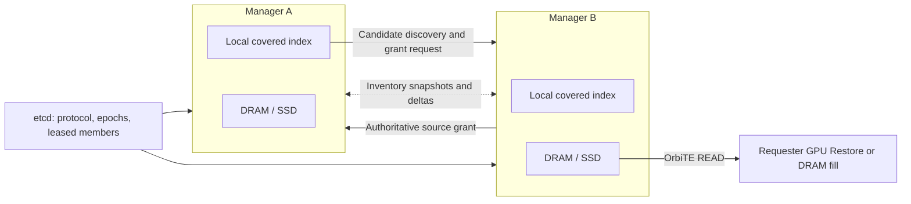

# Distributed cache design

Each Manager owns local DRAM/SSD and a covered index of peer replicas. Etcd holds
protocol identity, persistent node epochs and leased membership. Bounded owner
inventory streams carry snapshots/deltas; ordinary queries use the local index,
then obtain an authoritative source grant before OrbiTE transfers bytes.

Start with [P2P deployment](p2p.md). Current support stays at four owners;
historical two-H20 RDMA evidence does not qualify the current OrbiTE path.
Full cache HA, physical failure domains and sixteen-owner support remain unqualified. See
[compatibility](compatibility.md).

## Local global index and etcd metadata

`ResidencyInventory` is the source of residency truth. `GlobalIndex` is the
requester's local candidate index. Membership/format use etcd; block churn uses
peer inventory streams rather than per-block etcd records or lookup RPCs. No
second Catalog or directory process is required.

The current format is `orbitkv/inventory-stream/v5`. Stop all Managers before
format migration. Use `scripts/migrate-metadata-format.py` to dry-run, archive
and CAS the namespace. Mixed old etcd-block/v3/v4 metadata paths are unsupported.

## Owner inventory streams

Each directed session binds cluster UUID, source epoch/incarnation, requester
incarnation, scope description/digest and a random session ID. Receiver snapshot
staging remains hidden until complete pages and contiguous replay validate and
install atomically. Frame-consumption ACKs return stream byte credit; they do
not assert installed visibility.

Deltas coalesce exact state/medium identities over a contiguous source interval.
Filtered empty intervals preserve sequence coverage. Duplicate replay is
idempotent; gaps, overlap, identity conflicts and incomplete snapshots never
partially install. Reconnect, overflow and retired owners require a complete
replacement snapshot. Membership refresh cannot reactivate a budget-retired
owner by itself.

Stream interruption makes coverage partial; membership removal excludes the old
incarnation immediately. Source grants revalidate authoritative current ownership,
so a stale index hint cannot authorize a stale replica. Normal Manager shutdown
fences membership before inventory/lifecycle drain and stops new inventory frames.
Session counters are released on task cancellation.

## Scope and bounded resources

Omitting scope selects all namespaces. Repeat `--metadata-namespace` with actual
`orbitkv:v2:<64 lowercase hex>` namespaces for an exact allowlist, or use
`--metadata-empty-scope` for no remote namespaces. Scope changes require restart
and full bootstrap; old cursors/late frames cannot establish new coverage.
Filtering does not provide tenant authentication or remove all-to-all sessions.

Frames are limited to 1,024 records and 512 KiB encoded/decoded content. Current
bounds include 1 MiB messages/per-stream credit, 32 MiB aggregate outbound credit,
128 sessions per direction, two served/received snapshots, 64 fence awaiters and
16 MiB/s source pacing with a 1 MiB burst. Reconnect backoff is 100 ms to 3 s.
Scopes allow at most 256 namespaces and a 64 KiB encoded Open.

`--index-budget` charges active and hidden staging views together. Incomplete
coverage cannot support a cluster-wide absence claim. Evicted/retired owner
views stay excluded until complete replacement installation. Local cache
operations remain available for namespaces outside remote discovery scope.

## Synchronization and diagnostics

`POST /cache/sync` drains submitted local saves and, in distributed mode,
returns an inventory fence with protocol, cluster UUID, source epoch/incarnation
and sequence. It does not wait for requesters. Standalone mode returns
`local_flush_complete` without fabricating an inventory fence.

A controlled requester uses `POST /cache/metadata/await` with the fence, exact
scope digest and timeout up to 30 seconds. Success requires a committed matching
owner view and valid membership. Ordinary queries never execute this barrier.

`GET /cache/metadata` exposes membership revision/validity, scope and coverage,
active/staging/accounted index bytes, expected/installed owner views, stream
bytes/frames, session counts, journal state and queue high-water marks.
Ordinary publication-to-install visibility is distinct from serial harness
verification time. Inspect membership traffic separately from stream traffic.

## Residency, proximity and access paths

A candidate names an exact state key, representation, stored size, medium,
source endpoint and incarnation. Matching hashes do not make incompatible
engine byte layouts interchangeable. A complete local miss is meaningful only
inside the declared scope and membership cut.

Remote DRAM transfers use a source export held through completion. Remote SSD
is read/staged by its source owner before export. The current Manager route is
remote DRAM/SSD → OrbiTE READ → destination GPU (or DRAM for cache-tier fills). A GPU-pointer
RDMA component test does not imply that this route directly exports live engine
HBM or qualifies GPU-direct operation.

## Application and transport boundary

| Operation | Implemented path |
| --- | --- |
| Block discovery | Complete local global index; no foreground network query |
| Inventory publication | Bounded Manager inventory streams |
| Index synchronization | Covered inventory snapshots and deltas |
| Membership/incarnations | Background etcd registration, lease renewal and Watch |
| Source grants/completion | Bounded batched OrbitKV gRPC |
| Remote payload | OrbiTE READ under source grants |
| P/D payload | Inference engine native transport |

Admission, incarnation/generation fences, idempotent completion and retry
ownership belong to OrbitKV. OrbiTE owns registered-memory transfer and native
completion. SEND completion, receiver ACK and drained payload READ are distinct
events. A metadata lease or dead requester cannot prove old READs have drained.

Keep one active READ and at most one authorization lookahead. Submitted work
owns its source guard and destination buffers until native drain. A bounded
completion owner retries release until acknowledged. Index replacement must
preserve these implemented limits and ownership.

Live P/D uses each inference engine's native transport; OrbiTE handles Manager
sharing. See [P/D composition](pd.md). The custom router is removed.

## Transfer lifetime and resource control

Query admission owns byte credits and destination reservations. Source grants
own the authorized representation and backing bytes. Index hints, membership
leases, network credits and source memory lifetimes are separate contracts.
Cancellation, timeout or requester disappearance cannot prove physical DMA drain.
Unknown work retains its buffers/registrations until a valid termination proof;
bounded retention is observable and cannot be described as completed reclamation.

Keep replica discovery in Catalog, source authority in existing peer/storage
owners, and payload work in the transfer owner. Deterministic replica selection
stays in the existing [planning owners](architecture.md#planning).
Native engine P/D has an independent transport and destination ownership.

## Limits and validation

Current CPU controls cover migration, quota, journal overflow, membership, scope
and shutdown; see [cluster benchmarks](https://github.com/OrbitInfra/OrbitKV/blob/main/benches/cluster/README.md) and
[fault gates](fault-qualification.md#shared-cache-gates). Missing coverage blocks
remote admission without blocking local cache operation. The supported inventory
scope remains four owners. Historical DRAM/SSD isolation is **FAIL** and sixteen
owners remain **UNQUALIFIED**; process-only etcd controls are not independent
failure-domain or cache-HA evidence. See [qualification limits](performance.md#qualification-limits).
