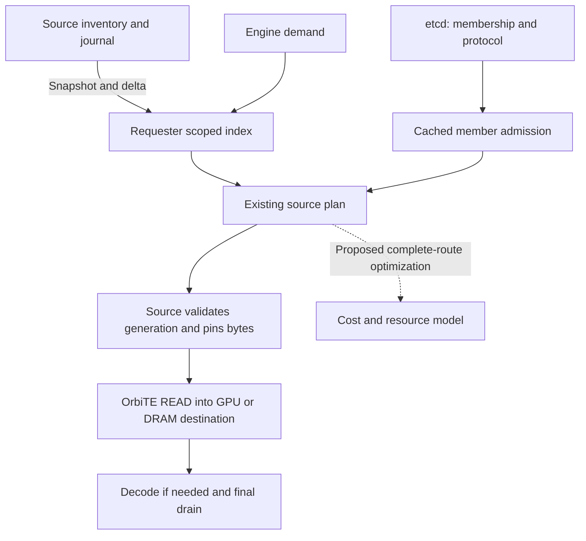

# Distributed inventory and recovery design

This page specifies inventory replication and its boundary with recovery planning.
For deployment use [P2P](p2p.md); for the short architecture use
[distributed cache](distributed-cache.md). The [completion plan](completion-plan.md)
is the only delivery/status record. A design target is not a qualification claim.

## Outcome and design contributions

Each Manager owns its DRAM/SSD inventory and publishes bounded snapshot/delta
streams to requester-local indexes. Etcd traffic depends on membership rather
than block churn. Discovery is local; source grants and physical completion
remain the authorities for access and reclamation.

The contracts are versioned inventory cuts, explicit subscription coverage,
bounded resources and separate metadata/payload progress. Complete cost-driven
recovery selection remains a design extension, not a consequence of faster
metadata. These are established systems techniques, not research-priority claims.

## References and decisions

The [pinned reference audit](https://github.com/OrbitInfra/OrbitKV/blob/1f30895a0501670cabe16e64eeb5688e05a2aa54/docs/distributed-design.md#references-and-decisions)
compares FlexKV `738ddc14`, Mooncake `71973589` and etcd Watch guarantees.
Borrow local discovery, batching and owner authority without adding a routing
Master or copying their support claims. Moving block metadata out of etcd moves
ordered history and snapshot responsibility into this protocol; it does not
remove those obligations.

## Present implementation and intended changes

| Responsibility | Implemented owner | Limit |
| --- | --- | --- |
| Residency | `ResidencyInventory`, DRAM/SSD owners and bounded journal | No durable SSD restart |
| Membership | etcd format, epochs and leased members | No per-block records or request-path etcd reads |
| Discovery | `GlobalIndex` with scoped owner streams and explicit coverage | Positive hints still require source validation |
| Payload | Source grants, bounded pins and OrbiTE READ | Metadata ACK is not drain |
| Selection | Bounded candidates and opt-in limited cost choices | General complete-route optimization remains future work |

The streaming service shares the peer listener. It introduces no directory lookup
RPC, standalone Catalog, Python coordinator or general region service. Engine HBM
export, durable restart, active replication and cross-engine byte conversion are
outside this inventory contract.

## Invariants

1. Local save/eviction cannot wait for metadata distribution.
2. `(incarnation, StateKey, medium, residency_sequence)` identifies a residence;
   equal content after eviction cannot reuse its old authority.
3. Filtering/coalescing preserves contiguous input coverage, including deletes.
4. Hidden snapshots become visible only after complete scan and replay.
5. Per-owner watermarks are not a globally atomic view or a model-state proof.
6. Membership expiry fences admission; healing needs a new incarnation.
7. Metadata ACK, receive credit, source grant, readiness and drain are distinct.
8. Queues, journal, staging indexes, pins and preparation have explicit bounds.
9. Local service survives metadata unavailability without admitting stale peers.

The cluster is trusted. UUID matching and namespace filtering fence identities;
they do not authenticate hostile tenants.

## Membership and etcd layout

The common `/orbitkv/v2/<cluster>/` prefix contains an exact format guard:
`protocol = orbitkv/inventory-stream/v4` plus a persistent random cluster UUID.
The historical `v2` path does not imply an old decoder. Registration compares the
format value/revision in the transaction claiming membership, so incompatible
binaries cannot silently form separate populations under one cluster name.

| Key | Lifetime | Contents |
| --- | --- | --- |
| `format` | Persistent | Protocol and cluster UUID |
| `epochs/<node>` | Persistent | Monotonic CAS-fenced registration epoch |
| `members/<node>` | Manager lease | Node, epoch, incarnation, concrete endpoint and capability |

No block locations, physical addresses, transfer grants, ACKs or load samples go
into etcd. Persistent epoch keys need inactive-node maintenance independently of
live member count. Renewal and Watch remain separate tasks. Bootstrap fixes an
etcd revision, resumes after it and validates coordinator identity. A membership
gap suspends remote admission; inventory interruption alone cannot invalidate
healthy membership. Submitted work remains owned through drain.

Independent etcd failure domains and WAL isolation matter; process-only tests
cannot qualify host/power/network faults. See [deployment](p2p.md#catalog-availability-and-etcd).

## Publication and coalescing

Read bounded contiguous journal intervals, coalescing by `(StateKey, medium)`.
For `put(v10), delete(v12), put(v17)`, transmit `put(v17)` with coverage through
17 only after all other interval effects are delivered. A final delete is sent
even if this connection never saw its put. DRAM deletion cannot remove SSD.

`--inventory-stream-coalesce-ms` defaults to 0 and accepts 0–5 ms. An explicit
fence bypasses intentional wait but not interval ordering. If a frame is too
large, shorten the input interval and coalesce again; splitting sorted output
keys cannot make each chunk claim complete input coverage. Exact records and
strict decoded-size bounds are required; compression cannot infer missing state.

## Background inventory protocol

A directed bidirectional `InventorySession` carries one canonical subscription.
Its independent bounded queues keep snapshot encoding away from grants, release
ACKs and membership tasks. It transports metadata only.

### Identity and messages

Each session binds protocol, cluster UUID, source epoch/incarnation, requester
incarnation, scope digest and random session ID. Membership is checked at open
and before more frames. Delayed replaced-session frames cannot mutate a new view.

Scope uses domain-separated SHA-256 over a versioned length-framed encoding of
`AllNamespaces` or sorted unique exact namespaces. Empty explicit scope means
none. Unknown enums, invalid widths and overflow reject the message.

| Direction | Message | Meaning |
| --- | --- | --- |
| Requester to source | `Open(scope, resume_sequence?, installed_view_id?)` | Start from retained receiver evidence, or request bootstrap |
| Source to requester | `SnapshotBegin(snapshot_id, start_sequence)` | Establish hidden bootstrap state; not yet queryable |
| Source to requester | `SnapshotPage(snapshot_id, page_number, records)` | Bounded, sorted scan records with their own residence sequences |
| Source to requester | `Delta(from_exclusive, through_inclusive, records)` | Final per-key effects for a contiguous input interval |
| Source to requester | `SnapshotCommit(snapshot_id, through_sequence, transcript_digest)` | Finish scan/replay and atomically install that owner view |
| Source to requester | `Progress(through_sequence)` | Empty interval progress; not permission to skip unsent changes |
| Requester to source | `Ack(consumed_frame_id, installed_view_id, applied_sequence)` | Batched frame credit and separately committed progress; never payload authority |
| Requester to source | `FlushThrough(target_sequence)` | Diagnostic or explicit barrier priority; not an ordinary query RPC |
| Source to requester | `ResetRequired(reason)` | Resume history or receiver state cannot be trusted; rebootstrap |

Data frames have encoded and decoded bounds. Snapshot digests validate the
transcript, not semantic completeness, authentication or durability. Monotonic
frame IDs and a bounded outstanding-byte ledger ensure ACK credit returns once;
future/duplicate ACKs cannot enlarge the window. Copying a page into hidden
staging may return frame credit without advancing installed visibility.

### Incremental application

A receiver at `a` accepts a complete validated delta `(a,b]` atomically with its
cursor and peak accounting. Every record sequence lies in that interval; omitted
positions require source-proven filtering/coalescing. A record's generation and
a stream watermark are different. Decode and network waits stay outside the
query lock; same-generation conflicting records reject the frame.

`b <= a` is a duplicate in the same view lineage. Partial overlap resumes from
`a`; a gap requests repair. Reconnect regenerates intervals from installed state,
not an unbounded per-subscriber log. `Progress` advances only a proven empty
interval or repeats installed progress. Liveness cannot invent coverage.

### Snapshot with concurrent mutation

1. Capture journal head `S0` and create hidden staging.
2. Scan ordered resident records with a monotonic `(StateKey, medium)` cursor,
   releasing locks between pages and retaining each record's real sequence.
3. Capture `S1` after the last page and replay the entire interval `(S0,S1]`.
   Apply versions so older replay cannot replace newer scanned state.
4. If history is unavailable, discard staging and retry under bounded backoff.
5. Validate page/frame ordinals, replay coverage, maximum scanned sequence and
   transcript; atomically install at `S1`, then continue deltas.

An insert behind the scan cursor is supplied by replay; a later delete removes
its scanned row. A commit marker cannot replace missing pages. Lost commit ACK
can resume only an actually retained committed view; otherwise bootstrap again.

Old installed rows may remain stale positive hints during repair while membership
is valid; staging never does. Charge both views. If replacement exceeds budget,
withdraw the owner/scope before rebuilding rather than expose a truncated complete
view. Local mutation never waits to preserve an overflowing journal.

### Receiver and membership transitions

| Event | Receiver action | Payload ownership |
| --- | --- | --- |
| Bootstrap | `Syncing`; staging is hidden | Unchanged |
| Snapshot commit | Atomically install owner view and watermark | No payload is pinned by installation |
| Stream interruption | Keep last installed positive hints; mark freshness unknown | Source revalidates every new grant |
| History gap | Repair affected owner view; completeness false until commit | Unchanged |
| Source member removed/replaced | Immediately exclude old owner from candidate admission; retire its rows in bounded batches | Submitted work waits for drain |
| Requester lease expires | Fence all remote admission and sessions | Existing owners remain until completion proof |
| Membership snapshot invalid | Suspend remote admission; repair membership first | Local service and draining work continue |
| Invalid frame or budget failure | No partial apply; close/reset affected session | Does not revoke a payload grant |

Admission invalidation is immediate; row cleanup is bounded asynchronous work.
Reverse-index/accounting costs remain inside the same `GlobalIndex` budget.
Peer retirement also fences every requester's OrbiTE identity; see
[physical retirement](transport.md#peer-departure).

## Subscription coverage and local query semantics

Omission selects all namespaces. `--metadata-namespace` selects exact generated
storage identities; `--metadata-empty-scope` selects none. At most 256 namespaces
and a 64 KiB Open are allowed. Change scope by restart and full bootstrap. Model
names, prefixes and query misses cannot select an implicit namespace. Local cache
service can work outside remote scope; filtering does not reduce session fanout.

| Coverage | Permitted interpretation |
| --- | --- |
| `CompleteAtWatermarks` | Every expected owner has a committed scoped view; absence only at those cuts |
| `PartialHints` | Some views are missing/repairing/stale; positive hints can be revalidated |
| `Unavailable` | Invalid membership, unsubscribed scope or no usable evidence; use local recovery/recompute |

A completed empty owner differs from a missing one. Coverage updates incrementally;
ordinary queries do not build an all-member watermark vector. Candidate limits
remain 128 keys / 64 KiB and four replicas per medium. Truncation gives positive
evidence, not the complete replica set. Freshness uses requester receipt age;
source head advertisements cannot advance applied coverage. Model/rank recovery
checks remain necessary even with complete metadata.

## Synchronization API cutover

`POST /cache/sync` waits for submitted local saves and returns the source's
protocol/cluster/epoch/incarnation/sequence fence in distributed mode. It requests
prompt publication, not requester visibility, payload retention or durability.
Standalone mode returns `local_flush_complete` without a distributed fence.

`POST /cache/metadata/await` accepts that fence, exact scope digest and timeout
at most 30 seconds; at most 64 waiters are admitted. It succeeds only with valid
membership and a committed matching view through the target. Filtered progress
proves nothing outside scope. It observes the existing stream, never opens a key
lookup. Ordinary queries do not call either diagnostic barrier.

## Resource bounds and scheduling

| Resource | Bound/default |
| --- | --- |
| Source journal | 16 MiB, without unbounded subscriber retention |
| Interval/frame | 1,024 records / 512 KiB; 128 KiB record cap |
| gRPC message / per-stream credit | 1 MiB each |
| Index | 256 MiB logical default including active/staging/reverse/apply growth; not an RSS cap |
| Aggregate outbound credit | 32 MiB per Manager |
| Sessions | 128 each direction; parser limits do not qualify all-to-all capacity |
| Snapshots | Two served and two received, also subject to bytes |
| Source pacing | 16 MiB/s with 1 MiB burst |
| Reconnect | Jittered 100 ms–3 s backoff |
| Idle progress | 1 s; membership has independent lease validity |

Limits precede allocation. Metadata and payload credits are separate; HTTP/2 flow
control alone is insufficient. Namespace filtering reduces record bytes, not
all-to-all sessions. Beyond the measured envelope, use explicit sharing domains
rather than silently omit peers and claim completeness.

For N Managers, U aggregate effective mutations/s and mean record bytes B, full
fanout still costs about `(N-1)*U*B` bytes/s. Receiver storage scales with scoped
residency. Source filtering CPU, framing, allocator overhead and reconnect scans
remain real costs. Journal capacity needs headroom above change-rate × snapshot
duration; when insufficient, repair must stay bounded and preserve local service.

## Complete recovery route selection

This is a proposed extension governed by [planning contracts](state-planning.md).
Inventory optimization does not implement it.

### Inputs and eligibility

Use declared recovery ranges, bounded replica evidence and equal completion
targets. HostReady cannot compare as GPU-ready. Acquire real generations and
leases; recomputation requires a consumed engine contract, not a cache-side
compute command.

### Objective and bounded search

Compare predicted usable-state time under memory, deadline and resource bounds.
Unknown evidence preserves deterministic eligible order. Estimate the dependency
critical path without summing parent/child timers twice. The
[original search and evaluation targets](https://github.com/OrbitInfra/OrbitKV/blob/1f30895a0501670cabe16e64eeb5688e05a2aa54/docs/distributed-design.md#objective-and-bounded-search)
remain proposals, not active selector settings.

### Consumption and replanning

Selected routes need source/extent leases, destination authority and credits.
Pre-submit rejection can release unused reservations and replan within the same
deadline. Submitted work retains its original completion owner; no competing
write or cross-medium retry can treat cancellation as drain.

### Freshness and resource evidence

Inventory generations authorize only after source revalidation. Disposable load
summaries need incarnation, age and uncertainty, and never become reservations.
Do not publish each queue change to etcd or compare monotonic clocks across hosts.
Urgency cannot skip stream intervals and advance a false watermark.

## Receive credits, interference and retention

Node-wide pacing across Manager READ and native engine P/D is future work.
A Manager-only byte limit cannot claim to control NCCL or independent submitters.
Network progress returns network credits; source and destination memory follow
their own final users. Expiry cannot replenish capacity an old submitter may use.

Retention needs a real storage reservation and semantic liveness, separate from
copy completion. Minimum replica counts, active WRITE replication and automatic
cross-domain migration are not current guarantees. Their design/acceptance queue
belongs only to the [completion plan](completion-plan.md#s6--one-consumed-route-and-admission-planner).

## Diagnostics

Use `/cache/metadata` and paginated `/cache/metadata/owners`, with
[metric semantics](metrics.md#distributed-metadata-progress). Report membership,
coverage, scope, journal/queue/index high-water marks, install progress and resets.
Metrics cannot carry unbounded block/request/namespace labels. Same-host exact
sequence timestamps measure publication/install; HTTP observation and barrier
verification are separate. Raw sampled traces stay outside Git.

## Failure and correctness qualification

These are boundary assertions, not a request for every expensive case in default
CI. Use deterministic interval tests plus real-etcd/Manager controls and an
independent mutation/byte oracle. Source inventory fences and scoped requester
awaits replace the retired etcd-block oracle.

| Fault/workload | Required assertion |
| --- | --- |
| Put/delete/reinsert, both media, group zero | Exact final keys and latest sequences; no resurrection or cross-medium delete |
| Filtered intervals and zero-record owner | Watermark advances only with proven interval coverage; empty completed view differs from missing view |
| Duplicate, overlap, gap, invalid identity/enum/size | Idempotence or explicit repair; no partial apply or cursor advancement |
| Coalesced interval exceeds frame/transaction size | No early watermark from sorted output; every covered key commits before barrier success |
| Snapshot insert behind cursor, delete after page, repeated reuse | Exact convergence to an independent source-state oracle |
| Journal overflow during scan/replay | Abort hidden snapshot, bounded retry, local service continues |
| Lost snapshot commit ACK, reconnect, receiver restart | Resume only retained committed evidence; otherwise bootstrap |
| Slow subscriber, blocked stream writes, frame decode pressure | Global/per-stream bounds hold; source mutation and lease tasks progress |
| Index budget exceeded with active plus staging | Explicit coverage downgrade; never expose a truncated complete index |
| Member join/leave, endpoint reuse, source restart | Old sessions and generations cannot authorize new reads |
| etcd quorum loss beyond lease validity, heal | No old-incarnation revival; local cache works; new runtime rejoins |
| Source/requester crash with submitted READ | Byte correctness, retained pins/credits and eventual safe reclamation where S3 provides proof |
| SSD-only source and receiver-local eviction | Actual SSD reads and remote fetches; DRAM hits cannot mask the route |
| Mixed namespaces and incompatible representations | No cross-scope lookup leakage or semantic compatibility shortcut |
| Native engine serving and hybrid boundary | Required groups complete before matched-token/ready claims; strict output controls |

Run frozen native builds before services, sequentially. Maintained integration
and shared-cache gates are in [the test guide](../python/tests/README.md) and
[shared-cache qualification](shared-cache-qualification.md).

## Performance acceptance and ablations

The original frozen requirements remain unchanged:

| Gate | Initial acceptance target |
| --- | --- |
| Correctness | Zero incorrect bytes, lost final mutations, stale-incarnation authorizations or incomplete-as-complete claims |
| Hot discovery | Zero coordinator/directory RPCs per ordinary lookup; source grants remain allowed and counted separately |
| etcd decoupling | Zero block/cursor publication mutations in the streaming profile; fixed-membership etcd load must not grow with injected block churn |
| Visibility | Initial same-host TCP, 16-owner baseline target: p99 at most 50 ms; report cold/barrier-forced and ordinary asynchronous cases separately |
| Bounds | No configured queue/journal/index/credit overshoot; include active plus staging and report measured RSS separately |
| Isolation | Local save/query p99 regression at most 5% versus matched baseline during metadata-only pressure, with per-run uncertainty |
| Recovery | For the baseline envelope, p99 bootstrap/repair no worse than 1.10 times frozen baseline; exact convergence required independently |
| Scoped fanout | Delivered residency events equal the matching-scope oracle; lower bytes demonstrated without losing in-scope candidates |
| Executed routing | At least 10% p95 or p99 ready-time improvement on two predeclared contention cases, with no more than 5% cold/noncontended serving regression |

The [full measurement contract](https://github.com/OrbitInfra/OrbitKV/blob/1f30895a0501670cabe16e64eeb5688e05a2aa54/docs/distributed-design.md#performance-acceptance-and-ablations)
preserves `s2.10-performance-v2`, independent-pair counts, workload/cadence,
visibility endpoints, payload oracle and all uncertainty/overhead guards. Barrier
verification is not ordinary visibility; all/scoped filtering is not quiet/pressure
isolation. Do not relax thresholds after a failed run or count correlated requests
as independent experiments. Current verdicts stay in the [completion plan](completion-plan.md#s2--metadata-reliability-and-measured-capacity).

### S2.10a same-host isolation diagnostic contract

The accepted `formal-qualification-2` cohort proves valid pressure and failed
DRAM/SSD isolation, not causation by a specific lock or I/O. The
[frozen diagnostic contract](https://github.com/OrbitInfra/OrbitKV/blob/1f30895a0501670cabe16e64eeb5688e05a2aa54/docs/distributed-design.md#s210a-same-host-isolation-diagnostic-contract)
retains its hypotheses, stage clocks, pilot and rejection guards. Diagnostic
off/on overhead must pass before formal diagnosis; it cannot replace isolation
qualification. Fix an identified owner, not a speculative scheduling layer.

## Code ownership and removal map

| Owner | Responsibility |
| --- | --- |
| `orbitkv-state` | Bounded inventory, coverage and fence contracts |
| Core `storage/inventory.rs` | Residency authority, journal, coalescing and scans |
| Server `cluster/` | Membership, renewal/Watch and inventory sessions |
| Catalog index/membership | Atomic scoped views, budgets and admission |
| Manager HTTP | Diagnostic fences, awaits and status |
| Core `planning/`, `query/`, `peer/` | Candidate acquisition, source grants and physical completion |

No second block publisher or Catalog truth source is retained.

## Cutover, rollback and handoff

Protocol migration is offline: stop/drain every Manager, archive the namespace,
dry-run `scripts/migrate-metadata-format.py`, then exact-CAS the common guard while
preserving epochs. Live-member checks cannot replace stopping mid-registration
processes. New Managers start fresh incarnations and reject old protocols.

Rollback also drains/stops all Managers and uses frozen binaries with fresh
metadata, never restores live leases/grants or old cursors. Startup truncates
SSD files; rollback cannot force release of unknown native work. The
[review contract](completion-plan.md#review-contract-for-every-delivery) defines
handoff and independent acceptance.
