# Compiled hybrid recovery

The official vLLM 0.31.0 profile requires V1 with one attention cache group
(`VLLM_USE_V2_MODEL_RUNNER=0`); multi-group/recurrent serving is rejected.
SGLang 0.5.22's released external linker supports Full and SWA components;
OrbitKV rejects recurrent/SSM startup. Full MHA/MLA and Full + SWA are implemented
SGLang layouts, with model qualification recorded separately in
[compatibility](compatibility.md) and [model recipes](models.md).

The shared Rust recovery contract can describe attention, windows and exact
checkpoints. The sections below explain its group-read and layout implementation,
not permission to enable every combination in a released engine. Recurrent/conv
model recipes and earlier hybrid serving results are historical. A valid
attention prefix alone is insufficient to restore a model that also reads
recurrent, convolution or auxiliary state. See the
[released interface audit](engine-release-audit.md).

## Rules and runtime ownership

| Registered group | Rule at token boundary t | Physical state |
| --- | --- | --- |
| Full attention / MLA | Contiguous prefix through t | Engine-owned attention pages |
| Sliding window | Complete trailing window through t, rounded up to pages | Independent SWA K/V pages |
| Recurrent / convolution | Checkpoint exactly at t | All conv and temporal tensors in one sealed group |

`orbitkv-state::RecoveryContract::compile` normalizes declared groups at adapter
setup: a prefix needs the whole queried tail, a window needs
`ceil(window / page_size)` pages capped by that tail, and a checkpoint needs only
its final page. The Python `required_ranges(namespace, start, end)` method
returns `list[(group, start, end)]`: absolute, half-open, page-aligned intervals
for each group, with `end` the chosen boundary. Complete valid engine state at
the HBM prefix origin `start` is a prerequisite; the contract does not establish
it. An empty span returns `(group, start, start)` for every registered group
and creates no new restorable boundary.

The same normalized requirements drive `restorable_boundaries`. Each adapter
converts leased hit positions to absolute token ends; validation rejects
mismatched namespaces, malformed coverage, unknown groups and gaps. It returns
every legal boundary: ranks intersect these sets, since taking the minimum of
their largest checkpoints could select a checkpoint missing on one rank.
Required ranges describe demand; live leased evidence establishes availability.

### Known-range example

With 64-token pages, a valid HBM origin at 128 and a selected boundary at 512:

| Declared layout | `required_ranges(namespace, 128, 512)` |
| --- | --- |
| Full attention (group 0) + 100-token SWA (group 1) | `[(0, 128, 512), (1, 384, 512)]` |
| Full attention (group 0) + recurrent/conv (group 1) | `[(0, 128, 512), (1, 448, 512)]` |

Combining the two auxiliary groups requires all three ranges at the same
boundary. The window rounds up to two pages; for
the shorter tail `[128, 192)` it needs only `[128, 192)`. The checkpoint requires
the page ending at the selected boundary, including all its conv/temporal tensors.
The output does not assert that any of these pages are cached or leased.

### SGLang lookup and restore

```mermaid
flowchart LR
  Pools[Declared group rules] --> Compile[Compiled page requirements]
  Tree[Valid HBM origin and known hashes] --> Query[Metadata-only discovery]
  Query --> Tiers[DRAM / SSD / global index]
  Tiers --> Evidence[Candidate group positions]
  Compile --> Validate[Validate legal boundaries]
  Evidence --> Validate
  Validate --> Select[Select common boundary]
  Select --> Demand[required_ranges]
  Compile --> Demand
  Demand --> Read[Read selected ranges and acquire leases]
  Read --> Check[Validate actual leased coverage]
  Check --> Restore[Restore required groups]
  Restore --> Fence[CUDA completion fence]
  Fence --> Resume[Engine resumes at selected boundary]
```

SGLang discovers positions in each registered group without loading payloads or
reserving payload bytes. Discovery inspects DRAM presence, the SSD index and
local global-index candidates. Rust intersects the compiled legal boundaries;
SGLang then intersects those sets across attention ranks. Metadata is a hint:
concurrent eviction or a remote restart can invalidate it.

Only the selected boundary enters `read_recovery`. Rust translates its
`required_ranges` into shared views of the original hash batch and reads those
pages. Attention needs the selected tail, SWA needs its trailing window, and a
recurrent group needs one checkpoint. Each returned group must have a live
lease covering its entire selected range; a partial result is released and
becomes a miss. Completed groups stay owned while others load. SGLang reports
host hits only once all ranks have complete leased state, before tree/GPU
allocation. Missing selected state falls back to the engine's valid HBM origin
and recomputation. Candidate discovery does not initiate warming.

Demand uses the existing bounded backing-read and cancellation machinery.
Sparse payload reads still have up to eight independent operations per group;
only metadata discovery is batched across missing hashes. Extra lookup rounds
are the cost of avoiding speculative payload reads; this change alone makes
no TTFT claim.

At load time, transferred keys and engine-attested retained keys must be
disjoint and together equal the keys in each compiled range. SGLang uses the
contract instead of Python formulas for each pool kind. All group leases remain
held until the combined restore completes. SGLang 0.5.22 owns private load
destinations until the post-forward `finish_layer_wise_loading` callback proves
that the batch has stopped writing. Only then can it insert or release those
slots. Unknown submission, timeout or lost completion raises while ownership
remains held; a logical failure is not a physical completion receipt.

SGLang owns HBM allocation and eviction. Its released external-linker wrapper
supports Full and SWA, not Mamba. OrbitKV rejects recurrent/SSM model startup;
the old custom recurrent component is removed. Generic state-layout byte tests
do not establish a model lifecycle or authorize that profile. Full hybrid
recovery needs a released complete-state contract plus model and fault gates.

## vLLM hybrid handoff

This describes the shared group-layout implementation. The current public vLLM
profile rejects multi-group/recurrent startup; these mechanics do not qualify
that deployment.

`CacheGroupLayout` maps vLLM's full-attention groups to storage group zero.
Each sliding-window or aligned Mamba group gets an independent storage key and
window/checkpoint requirement. vLLM includes the next query token in its window,
so a window of W requires W-1 past tokens, rounded to complete pages. Windows
must include at least one past token. The scheduler compiles these
requirements once in `RecoveryContract`. Rust computes the legal boundary
intersection from candidate positions on every shard. Before materialization,
the scheduler limits selection to the last token boundary usable by vLLM;
the final prompt token still needs forward computation for logits. This avoids
fetching a later checkpoint only to discard it during allocation.

The selected attention prefix, trailing windows and exact checkpoints use `read_recovery`.
Ready groups remain leased while other groups load; `Loading` defers admission.
If any actual range is missing, all owned groups are released and the request
recomputes. The existing five-second preparation limit, request drift, cancel,
shutdown and session teardown retire interests; submitted I/O retains its
buffers until completion. The operation and lease lifecycle is shared with
dense queries, including byte-budget admission.

Allocation must preserve the selected checkpoint exactly. Lease positions stay
relative to the original queried tail so the worker can map a one-page
checkpoint to the right GPU slot. Required attention pages and conv/temporal
state move into one restore operation, owned through GPU completion. There are
no surplus attention/checkpoint leases after final-token clamping. HBM
allocation and inference scheduling stay in vLLM. Dense queries and P/D's
explicit handoff want-sets retain their separate existing demand behavior;
hybrid P/D partial tails and cross-engine byte reuse remain unsupported.

The worker maps window leases by their query-relative page positions, preserving
null destinations outside the required window. Window pages can retire while
their request is still executing. Their save jobs pin GPU blocks independently
of request lifetime and release them only after every worker reports completion.

## Scope and production-cache lessons

Compilation here turns declared semantic requirements into deterministic page
demand for a known range. It removes duplicate adapter arithmetic and bounds
payload reads by the selected recovery boundary. No latency or throughput improvement has
been measured for this increment. General model-graph analysis, numerical proofs,
future-token prediction, retention policy and physical planning remain outside its scope.
A required range grants neither a lease nor permission to reclaim state, and
does not enable automatic hybrid warming.

The [pinned production-cache source review](queued-warming.md#reference-implementations-and-policy-order)
informs this work. OrbitKV applies the usable-boundary lesson to demand that
includes every required component. LMCache's request reader locks and Dynamo's
session holders illustrate consumer ownership; existing OrbitKV leases retain
pages through GPU completion. HiCache's stopping policies inform
[bounded preparation](request-preparation.md): stop new reads, drain submitted
work and return only completed legal boundaries. Automatic hybrid preparation
remains open. These are established cache lessons,
not a novelty or performance claim.

## SGLang deployment and limits

Use the [current dense recipe](single-node.md#sglang). The plugin accepts Full
MHA/MLA and Full + SWA contiguous, page-aligned pools. Attention groups must cover
disjoint layers and together cover the model. Recurrent/conv combinations are
not supported by the current SGLang plugin; the custom recurrent override and
its unused Inkling fixture have been removed. Unknown auxiliary state, moving
unified-memory pools and SWA request rings remain unsupported.

Complete hybrid recovery, page generations, physical fault reclamation,
multi-rank serving and cross-engine byte reuse remain separate qualifications.
A registered layout or passing state-byte fixture is not a model-serving result.

## Reproducible gates

Use the [maintained Python gates](../python/tests/README.md) for the current
native contracts, state-demand bytes and selected official-engine model profile.
Keep exact-byte and malformed/partial-evidence controls separate from model
output, restart and physical-lifetime gates. They measure correctness rather
than a latency or throughput advantage.

Earlier vLLM 0.29.0/SGLang 0.5.20 hybrid controls, Qwen3.5/Mellum/Inkling recipes
and their reproduction details remain in the
[pre-migration report](https://github.com/OrbitInfra/OrbitKV/blob/c407188168bffaef7cb98e197e636ee823399712/docs/hybrid-recovery.md#reproducible-gates).
Reproduce those results with their original source, wheel and engine freezes.
They are not deployment instructions or support claims for the current package.
