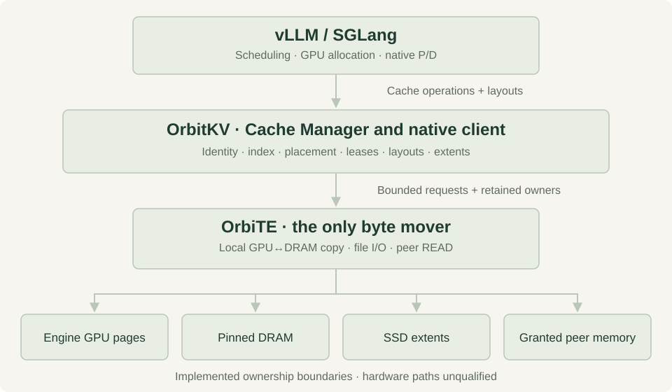
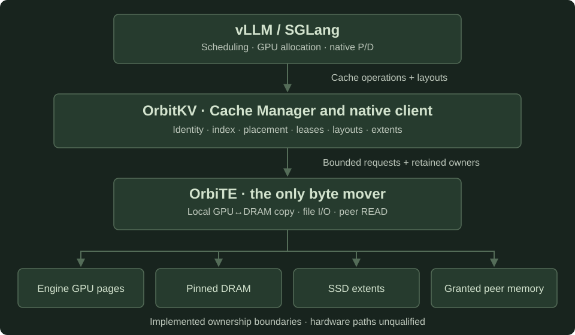

```{raw} html
<div class="orbitkv-hero">
  
  
</div>
```

(hero-title)=
# A distributed KV cache for vLLM and SGLang

Reuse compatible prefixes beyond GPU memory. An independent Cache Manager
owns DRAM, SSD and peer cache state; OrbiTE moves the bytes.

(get-started)=
(start-title)=
```{raw} html
  <div class="hero-links">
    <a class="primary" href="single-node/">Get started</a>
    <a href="compatibility/">Check support</a>
    <a href="completion-plan/">Read the plan</a>
  </div>
```

(stack-title)=
## Key features

- **Retain prefixes beyond HBM.** Reuse DRAM and optional SSD state across engine
  restarts while the Manager stays alive. SSD is recreated on Manager restart.
- **Share compatible state.** Discover peer replicas through bounded inventories
  and fetch them through authoritative source grants.
- **Keep ownership explicit.** Sources, destinations and registrations stay owned
  until physical drain. A timeout never permits reuse of their bytes.
- **Use one byte mover.** OrbiTE handles local GPU↔DRAM copies, SSD transfers and
  peer reads; engines retain scheduling, GPU allocation and native P/D.

See [features and limits](features.md) and the [engine support matrix](compatibility.md).
The current adapters target **vLLM 0.33.0** (V1 single-group or Full + SWA) and
**SGLang 0.5.23** (Full/SWA and static Mamba checkpoints; MLA per rank).
See the [admission limits](adapters.md#released-sglang-component-contract).

(evidence-title)=
```{note}
OrbitKV is unreleased. Current OrbiTE GPU, RDMA, GDS and installed profiles are
**unqualified**. CPU/TCP and io_uring controls are CI evidence; historical TENT
measurements do not qualify OrbiTE. Read the [evidence and methodology](performance.md)
and [release gates](releases.md) before choosing a deployment.
```

## Architecture

```{raw} html
<figure class="architecture-figure">
  
  
  <figcaption>Implemented ownership boundaries. Hardware paths remain unqualified.</figcaption>
</figure>
```

The [architecture guide](architecture.md) follows the owners and
[transport contracts](transport.md) distinguish ready from drained.

(learn-title)=
## Documentation

New contributors can follow the data flow: [transport](transport.md) →
[engine-local restore](engine-local-restore.md) → [distributed cache](distributed-cache.md)
→ [adapter contracts](adapters.md).

(getting-started)=
```{toctree}
:maxdepth: 1
:caption: Getting started

Overview <goals>
Installation and quickstarts <single-node>
Features and limits <features>
```

(supported-engines-and-models)=
(disaggregated-prefill)=
```{toctree}
:maxdepth: 1
:caption: Engine integration

Support matrix <compatibility>
Model recipes <models>
Engine adapters <adapters>
Prefill/decode composition <pd>
```

(storage-tiers)=
(distributed-kv-cache)=
```{toctree}
:maxdepth: 1
:caption: Storage and distributed cache

DRAM retention and SSD admission <cache-policies>
SSD, io_uring and GDS <gds>
Persistent SSD recovery <storage-persistence>
Formats and compression <storage-formats>
P2P deployment <p2p>
Discovery and source grants <distributed-cache>
Request preparation and warming <request-preparation>
```

(configuration)=
(production)=
```{toctree}
:maxdepth: 1
:caption: Deployment and operations

Deployment <deployment>
Manager configuration <server>
Fault behavior and qualification <fault-qualification>
Releases <releases>
```

(benchmarks)=
```{toctree}
:maxdepth: 1
:caption: Observability

Metrics and diagnostics <metrics>
Performance and methodology <performance>
```

(developer-guide)=
```{toctree}
:maxdepth: 1
:caption: Developer guide

Architecture <architecture>
Transport and completion <transport>
Engine-local restore <engine-local-restore>
State identity <state-identity>
vLLM request lifecycle <vllm-request-state-machine>
Hybrid recovery contracts <hybrid-recovery>
Contributing <contributing>
Completion plan <completion-plan>
```
