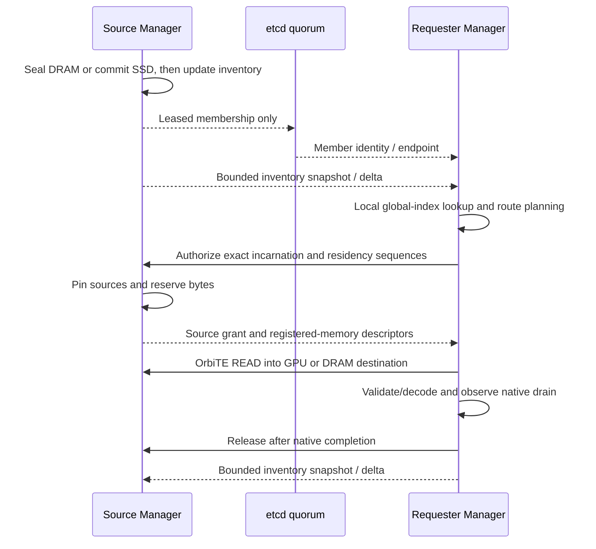

# Distributed KV cache

> OrbiTE is now the only transfer engine. GPU/RDMA/GDS and installed profiles
> require fresh hardware qualification. Earlier measurements retain their original
> revisions and backend (TENT where recorded); CPU/TCP and io_uring checks are CI
> evidence, not installed GPU qualification.

Every Manager keeps a local global index of advertised block locations. etcd owns
only the protocol identity, persistent node epochs and leased membership;
Managers exchange bounded inventory snapshots/deltas directly on the existing
peer listener. OrbiTE carries KV bytes. Source grants and release remain
OrbitKV gRPC. See the [protocol](distributed-cache.md).

## Leased Manager membership

All Managers use the same `--cluster-name` and etcd cluster; each has a distinct
stable `--node-id`. Supply multiple etcd endpoints for failover. Production metadata
HA requires a quorum deployed across failure domains. Index replication does not
replicate a payload held only by a failed Manager.

On host A:

```bash
orbitkv-cache-manager \
  --addr 10.0.0.1:50055 --pool-size 30gb \
  --etcd-endpoints http://10.0.0.101:2379 \
  --cluster-name inference --node-id cache-a
```

On host B:

```bash
orbitkv-cache-manager \
  --addr 10.0.0.2:50055 --pool-size 30gb \
  --etcd-endpoints http://10.0.0.101:2379 \
  --cluster-name inference --node-id cache-b
```

Use concrete peer addresses reachable from the other hosts. Peer gRPC and
OrbiTE's P2P handshake/data endpoints use separate ports. The default `auto`
transport lets OrbiTE choose among configured providers. Use `--transfer-transport tcp`
for a TCP control; RDMA requires `orbite-rdma` and explicit RNIC configuration.
When a proxy or test fault gate owns the advertised address, keep `--addr` as the
actual listener and set `--peer-advertise-addr` to the concrete address peers can
reach. It is an endpoint mapping, not a forwarding metadata service.

There is no separate MetaServer process or `--metaserver-addr` flag. Upgrade all
Managers together for this breaking protocol change. Engine processes retain the
same UDS/iceoryx2 and CUDA IPC integration described in the
[vLLM and SGLang deployment guide](deployment.md).

## Metadata subscription scope

Omitting scope flags subscribes to `AllNamespaces`. For an exact startup
allowlist, repeat `--metadata-namespace orbitkv:v2:<64-lowercase-hex>` using the
storage namespaces logged by actual engine registration. Do not substitute model
display names or prefixes: namespace identity includes computation,
representation and state-group inputs. `--metadata-empty-scope` explicitly
subscribes to no remote namespaces and is not the same as omission. Exact sets are
sorted/deduplicated, limited to 256 namespaces and a 64 KiB encoded Open.

The configured scope is immutable for the Manager process. Changing it requires
a restart and full bootstrap; old sessions, cursors and installed completeness
do not carry across. A scope-outside remote lookup is unavailable, while the same
Manager's local DRAM/SSD cache remains usable. Filtering happens at the source
for snapshots, replay and deltas, preserving original source interval coverage.
It is a metadata-volume control, not tenant authentication, and it does not remove
the all-to-all inventory session topology.

## Lookup and transfer



State identity must match model artifacts, computation, rank topology and storage
geometry. Source authorization, rather than metadata freshness, protects memory
reads. Validate vLLM-to-vLLM and SGLang-to-SGLang separately; these tests do not
establish cross-engine byte compatibility or hybrid-state completeness.

GPU-destined Restore keeps source descriptors/tickets until a bounded READ batch
can target persistent tensor or codec-input registrations. DRAM cache fills keep
host destinations; receiver placement uses its own GPU/NUMA topology, never the
source's NUMA IDs. Query sharing retains destination intent and deadline.

The host-fill reader permits one READ and one authorization lookahead. On source
resource exhaustion it can wait up to three seconds for that peer's already
pending releases, then retry authorization once. This is pre-submit admission,
not a payload replay or a reset of the read deadline. Lost authorization replies
use the known-ticket cleanup owner. Source release ACKs may outlive active READs;
64 per source incarnation / 1,024 globally bound completion records.
See [peer Restore](transport.md#peer-restore-into-gpu) and
[peer control](distributed-cache.md#application-and-transport-boundary) for retained owners and retirement.

## Failure and configuration behavior

- Registration requires an absent live Node ID, advances its persistent epoch,
  and binds the endpoint/runtime UUID and stream protocol to an etcd lease.
  Lease renewal and the membership Watch are independent of inventory sessions.
- Every requester installs one complete view per remote owner. A snapshot stays
  hidden until its ordered pages, contiguous replay, page count and transcript
  commit validate. Journal overflow resets only that owner view and restarts a
  bounded snapshot; it never exposes partial coverage.
- A disconnected stream retains its last installed positive hints as
  `partial_hints`. The source still validates every generation. Missing evidence
  does not prove absence until every expected owner view is complete.
- A completed empty owner view proves only that owner has no records in the
  configured scope at its installed watermark. It is distinct from a missing
  view and says nothing about scope-outside keys.
- Source UUID and generation checks prevent stale rows from authorizing reused
  addresses. Both DRAM and SSD can be advertised for one StateKey.
- Losing a Manager does not remove another Manager's index. A sole lost payload
  still requires another replica or recomputation. Removing its leased membership
  hides candidates even before all block-delete events arrive. Removal or an
  epoch/incarnation change also revokes cached transfer identities on every
  requester. OrbiTE closes and drains each identity. Neither timeout nor Unquiesced releases grants or pins.
  See [peer departure](transport.md#peer-departure).
- Losing an etcd member permits recovery through surviving endpoints if quorum
  remains. Losing quorum stops updates; new remote admission stops when local
  lease validity expires. Local DRAM/SSD operations continue, and submitted
  transfers retain their owners through completion.
- Registration is valid for half the acknowledged TTL measured from request send
  time. Once expired/fenced it cannot revive; restart for a new incarnation.
  Lease expiry or requester disappearance is not proof of native transport drain.
- Normal shutdown fences membership before asking gRPC to stop, so long-lived
  inventory streams finish before lifecycle drain and lease revocation. A test or
  supervisor must observe a zero exit code and member-key deletion; SIGKILL
  fallback is not graceful evidence. Same-node restart advances the epoch and
  uses a new incarnation. Aborted old follower tasks release their active-session
  diagnostics rather than accumulating phantom sessions.
- The connector currently uses HTTP etcd endpoints, without exposed TLS/auth
  configuration. UUIDs and transfer tickets are consistency fences, not peer
  authentication. Use a trusted cluster network.

## Catalog availability and etcd

There are two local structures: the **owner inventory** records real storage,
and the **global index** records installed owner views. Direct Manager streams
feed the latter; etcd never stores block locations or stream watermarks. There
are no assigned directory hosts, shards, TTL hint cache or request-time directory
fallback.

The versioned prefix remains `/orbitkv/v2/<cluster>/` so old and new Managers
cannot form disjoint populations. Its format record is now
`orbitkv/inventory-stream/v5` plus a persistent cluster UUID. Version 3 lacks scoped inventory; version 4 lacks required peer checksum
references. Both are rejected. Upgrade all Managers together using
`scripts/migrate-metadata-format.py`; mixed formats are rejected.

## Limits and observability

`--inventory-journal-bytes` defaults to 16 MiB per owner; overflow triggers an
owner snapshot. `--index-budget` defaults to 256 MiB and charges active plus
staging metadata. `--inventory-stream-coalesce-ms` selects a 0–5 ms quiet window;
the default remains 0 and 2 ms is an explicit throughput/freshness tradeoff.
`GET /cache/metadata` also reports `scope_kind`, the canonical scope digest and
exact namespace count. Coverage applies only to that scope and the captured
membership revision.

`POST /cache/sync` returns a source `inventory_fence`. A controlled requester
passes that fence, its scope digest and a bounded timeout to
`POST /cache/metadata/await`. Ordinary query paths do not call either endpoint.
Metadata status exposes coverage, owner-view counts, stream frames/bytes and
bounded queue/session diagnostics; `/metrics` retains payload, source admission
and completion measurements.

## Validation

For independent engine replicas, see [shared-cache qualification](fault-qualification.md#shared-cache-gates).
The source reservation budget is `--transfer-budget` (default: half the pinned
pool), with a maximum of 1024 active or overdue sessions. It charges entire pinned
allocations, deduplicated within each session, so a small slice cannot retain an
unaccounted large slab. Concurrent sessions each reserve their full allocation
footprint. Exhaustion returns a bounded miss to the requesting cache path.

Run native builds and runtime gates sequentially in a checkout; builds restage
OrbiTE build prerequisites. The etcd gate starts isolated temporary processes:

```bash
ETCD_BIN=/path/to/etcd cargo test --release \
  --no-default-features --features cuda-13,orbite,test-hooks \
  --lib cluster::tests::etcd -- --ignored

ETCD_BIN=/path/to/etcd ORBITKV_METADATA_ARTIFACT_DIR=/external/run \
  cargo test --release -p orbitkv-server \
  --no-default-features --features cuda-13,orbite,test-hooks \
  cluster::inventory::tests -- --ignored --nocapture --test-threads=1

ETCD_BIN=/path/to/etcd cargo test --release -p orbitkv-server \
  --no-default-features --features cuda-13,orbite,test-hooks \
  --lib cluster::tests::p2p_orbite -- --ignored
```

The etcd gate covers protocol/registration identity, incarnation restart,
compaction, leader loss and quorum-loss fencing. The ignored inventory-stream
gates cover atomic snapshots/deltas, journal-overflow repair, all-to-all capacity,
zero block keys and installed fence semantics. The GPU gate exercises source
authorization and OrbiTE READ across 260 blocks plus encoded payloads. Set
`ORBITKV_NVCOMP_LIBRARY` for the ANS case. These gates run on one host; physical
host loss and RDMA need their own qualification.

The Python process gate starts real etcd plus two Manager binaries, uses the
shared engine-facing client to restore GPU bytes remotely, then verifies local
restoration after stopping etcd. Set the binary path to prevent runtime tests
from starting a concurrent Cargo build:

```bash
cd python
ETCD_BIN=/path/to/etcd \
ORBITKV_CACHE_MANAGER_BINARY=/path/to/orbitkv-cache-manager \
PYTHONPATH=. ../.venv/vllm-release/bin/python -m pytest -m integration \
  tests/integration/test_distributed_cache.py
```

## OrbiTE TCP development profile

The default `orbite` build uses the same inventory, source grants and
generation-scoped release RPCs. `--transfer-transport tcp` is an explicit hint;
`orbite-rdma` enables the RDMA hint and configured devices. See the current
[engine contract](transport.md#transfer-engine) and [peer departure rules](transport.md#peer-departure).
CPU/TCP controls are CI evidence. GPU, RDMA and installed serving remain unqualified.
