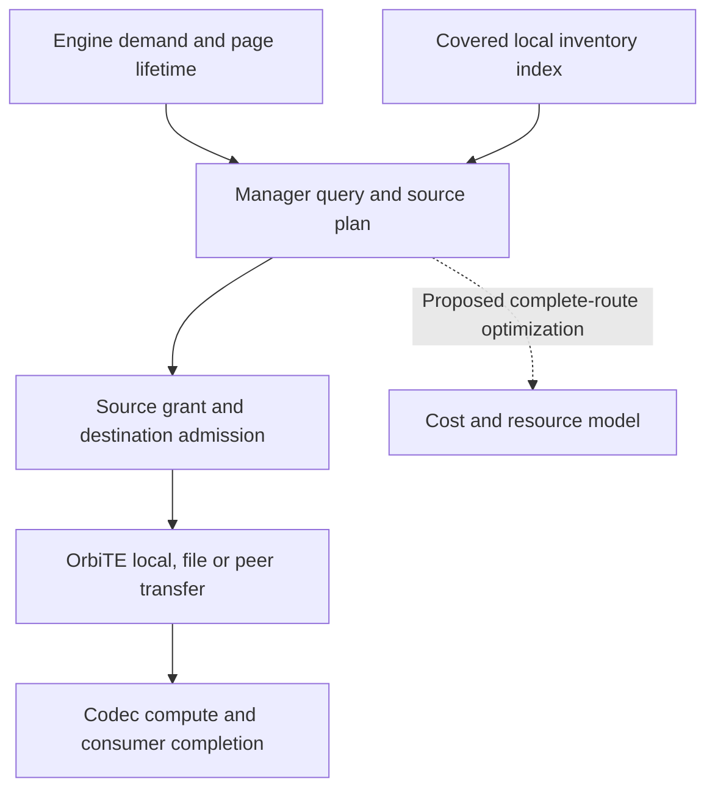

# State demand and transfer planning

OrbitKV validates declared recovery requirements, discovers bounded replica
candidates and acquires concrete source plans. Cost observations and limited
selection experiments are opt-in. A general consumed route/admission optimizer,
predictive placement and semantic retention remain design work in the
[completion plan](completion-plan.md), not implied by this page.

## Cache Manager decisions below the engine

The inference engine owns request scheduling and HBM allocation. Its local
Manager owns external replicas, recovery plans and admission. OrbiTE owns byte
movement, transport policy, slicing and staging. Worker routing is a separate,
optional integration; a single-node cache cannot depend on a router.

Discovery provides evidence, never payload authority. Each candidate retains
state identity, medium, representation, size and generation. Execution revalidates
and pins the exact source. Stale inventory may cause rejection, not stale memory
access. Source pressure summaries are neither reservations nor synchronized clocks.

Current peer selection first maximizes consecutive coverage. Optional measured
choice compares equal-coverage, same-medium HostReady routes with fresh estimates
for the same peer incarnation. Missing/incompatible evidence keeps stable order;
pre-submit rejection may replan within bounded admission. A joint local/peer
optimizer and source resource summaries are not implemented by that selector.

## What can be known ahead of time

| Evidence | Permitted preparation | Limit |
| --- | --- | --- |
| Tokenized queued request | Exact reusable prefix/component demand | Admission order may change |
| Scheduled batch or chunk | Required Restore and first consumer | Needs a callback before page use |
| Layer order | Later ranges while earlier layers consume | Graph replay needs device dependencies |
| Application workflow hint | Already-computed prefix likely to resume | Branch/time is uncertain |
| Historical reuse | Bounded retention or DRAM warming | No exact prediction of future tokens |

Declared demand, deadlines and cancellation come before learned prediction.
A likely reuse never authorizes eviction of a live GPU page.

## Engine signals and their present limits

The selected vLLM 0.31.0 profile uses V1 and one attention group. Its public
lookup can defer admission, and allocation callbacks supply valid destinations.
SGLang 0.5.22 exposes ready boundaries and public load completion; private
pending-admission and pre-capture Hooks remain necessary. See
[adapter contracts](adapters.md) for released APIs and rejected profiles.

Rust owns query revisions, cancellation, prepared claims and waiting. Python
supplies layout and engine lifecycle, creates one immutable `BlockHashes` batch
per lookup, and keeps GPU assignments. Per-layer readiness does not acknowledge
whole-operation drain. No adapter exposes an arbitrary future batch schedule.

## Minimal demand contract

`RecoveryDemand` carries page size, valid HBM token origin, selected end and
required group ranges through the existing channel. Registration supplies the
physical namespace. The Manager validates the complete group set and hash count
before admission; changed boundaries revise the query even with unchanged hashes.
An incomplete group receives no lease. Groups still execute separately, with
rank/model completeness owned by the engine.

Future planning inputs may add first-use estimates, confidence and destination
page generations. They must bind request/session revision, legal recovery state,
topology and a terminal owner. Current transfer intent/priority/deadline mapping
is already defined in [transport](transport.md#scheduling-metadata); it does not
supply joint multi-group scheduling. A candidate, reserved source, HostReady and
engine-ready result remain distinct states.

## Recovery semantics before placement

| State | Evidence needed at boundary t |
| --- | --- |
| Full attention | Complete required prefix groups |
| Sliding window | Complete model-specific trailing window |
| Recurrent/SSM | Exact checkpoint plus required convolution/attention state |
| MLA / sparse attention | Compatible latent/positional and required auxiliary bytes |
| Speculative decode | Accepted target-token boundary, not uncommitted draft state |

The shared [recovery contract](hybrid-recovery.md) checks engine-declared rules
against absolute leased coverage. A long attention match cannot compensate for a
short checkpoint. The engine must declare all state and keep the HBM origin valid;
validation is not an automatic proof of model mathematics or supported serving.
Current release guards reject unsupported hybrid/recurrent profiles.

Discover metadata first, select legal `required_ranges`, then acquire leases for
every required page. Stale partial evidence releases unsubmitted holds and lets
the engine recompute from its valid origin. Cross-engine layouts, dynamic LoRA
and live weight mutation have no implicit compatibility contract.

## Decide when to copy, retain, and restore

| Decision | Required inputs | Owner/result |
| --- | --- | --- |
| Restore | Legal boundary, replicas, representation and deadline | Source plan plus completion owner |
| Retain/publish | Reuse, capacity, write pressure and approved encoding | Actual DRAM/SSD reservation and committed replica |
| Admission | Demand, preparation and completion dependencies | Bounded slots/bytes; intent passed to OrbiTE |

Copy completion and semantic liveness are separate: producing a replica does
not authorize freeing HBM. Retained byte-seconds, transferred bytes and elapsed
time need explicit units/objectives rather than arbitrary additive weights.

### Unified replicas, routes and execution ownership

`ReplicaSet` retains local DRAM weak references, exact SSD versions and peer
owner/incarnation/inventory evidence. Discovery owns no payload. One residency
inventory advertises preferred DRAM or surviving committed SSD; pending writes
are not replicas. Ring overwrite/corruption removes SSD evidence.

`ReadPlan` declares HostReady or EngineRestore and holds batch candidates through
acquisition. Local DRAM comes first, followed by eligible deferred SSD Restore.
Host materialization tries peer DRAM, permitted local SSD io_uring, then peer SSD.
Explicit SSD routes cannot silently become host prefetch. The same records feed
peer and SSD plans; host reads pin exact indexed generations rather than relookup
by key. Cancellation retains queued/submitted leases through completion.

`RestorePlan` binds consumed source indices, target GPU, SSD route and source/
target shape, without owning payload. Workers reject mismatched devices/routes.
`LoadTask`, grants and workers retain leases, destination pages, query credits and
physical completion. Planning neither allocates memory nor owns CUDA streams.

| Residence | Executable boundary |
| --- | --- |
| Local DRAM | Shared arenas → engine-local OrbiTE copy |
| Local SSD | Exact extent → OrbiTE file vector into host or GPU destination |
| Peer DRAM | Source grant → OrbiTE READ into GPU Restore or DRAM-tier fill |
| Peer SSD | Source-owned io_uring host materialization → the same peer READ contract |
| Engine HBM as a general cache source | Not implemented; requires an engine generation-bound grant |

Keep logical state and physical representation distinct. The current namespace
already binds format/layout/TP/PP geometry; a new format field cannot merge
incompatible namespaces. GPU staging is temporary workspace, not an advertised
replica. Native P/D has a separate destination/hand-off owner.

### Cost model for complete routes

Compare equal required state at the same completion target. HostReady is not GPU
readiness. A key includes path, resource incarnation, representation and bounded
shape; correctness generations never become statistical or metric dimensions.
Unknown size, cost, mode or queue information stays unknown rather than zero.

Two estimation methods must remain separate:

- Matched complete-route observations include historical waiting already.
- Disjoint stage observations can form a dependency critical path, accounting
  for overlap and shared resources once.

Never add a parent route timer to its child I/O/copy/codec timers. EWMA absolute
error is an empirical margin, not calibrated p99 confidence. Admission snapshots
cannot reserve capacity. On pre-submit rejection, release unsubmitted reservations
and replan within the original deadline; after submission, retain the original
operation until physical drain. Unknown destination writes cannot be replayed.

### Code ownership and migration

| Owner | Responsibility |
| --- | --- |
| `storage/` | Residency, exact extents, publication and reclamation |
| `planning/` | Metadata candidates, eligible routes and target shapes |
| `query/` | Shared-read admission, materialization and lease handoff |
| `transfer/`, `peer/` | GPU worker/source authority and completion ownership |
| `peer/orbite.rs` | Native registrations, requests and physical receipts |
| `codec/` | Representation validation and compute |
| `cost/` | Bounded observations, estimates and shadow comparisons |

Worker pools remain instance-owned; GPU write admission is shared per device.
Automatic GPU SSD work may choose the host route before submission if device
worker admission is unavailable. Explicit cuFile demand fails closed. Accepted
jobs retain their permits through completion. See [GPU storage](gds.md),
[query budgets](server.md#query-ownership-budgets) and [architecture](architecture.md).

### Transfer paths and cost observations

OrbiTE owns local copies, file gather/scatter/staging and peer payloads. OrbitKV
keeps destination policy, source authorization and codec compute. Demand peer
READ goes directly to final GPU pages or codec inputs; Prepare/Warmup keeps DRAM.
Local GPU file vectors express holes/tails as padding. There is no OrbitKV GPU
SSD slot or native I/O fallback. See [transfer contracts](transport.md).

`--ssd-backend` controls configured file capability; `--ssd-read-path uring|cufile`
selects an explicit demand route for ablations. The latter names host/GPU routes,
not proof of native GDS. DMA/kernel selection is fixed at instance registration.
Neither shadow predictions nor successful io_uring bytes establish a native
GDS or GPU-direct RDMA route.

### Candidate routes and eligibility

Candidate enumeration is bounded by current evidence and implemented executors.
A peer SSD source must admit its own extent/staging resources before exposing a
registered window; requesters cannot schedule the peer's internals or recursively
fetch another peer. General peer-HBM sourcing, source-GDS peer export and mounted
remote-storage profiles are not current guarantees.

GPU RDMA is an engine transport capability, not another residence. Registered
destinations, device topology and physical lifetime must be valid independently
of a TCP/host-byte pass. OrbitKV does not duplicate OrbiTE's rail scheduler.

### P4.1 observation contract

This heading retains its stable link; the active contract is the bounded cost
observer in existing workers and source owners. It holds at most **512 entries**,
needs **four successful samples**, and expires after **five idle minutes**.
Keys separate resource/incarnation, representation, logarithmic bytes/fragments,
SSD source images and destination shape. Contention drops an update rather than
blocking execution. Identities never become exported labels.

| Sample | Completion boundary |
| --- | --- |
| Copy/codec/file operation | Submission through observed completion; queue/admission reported separately |
| `ssd_uring_restore` / `ssd_cufile_restore` | Enqueue through complete GPU Restore, including child movement/decode |
| Peer authorization | Source grant, including SSD preparation when needed |
| `remote_read` / `peer_gpu_restore` | Engine READ / direct GPU restore owner; distinct from H2D |
| Local/peer HostReady | Whole host preparation/reconstruction; one physical read can serve multiple consumers |
| `cache_restore` | Manager preparation after destination allocation through GPU completion |
| `engine_local_restore` | Native caller through local drain; excluded from unlike route starts |
| `prefill_to_decode_handoff` | Decode-owned handoff enqueue through physical drain |

Failed, cancelled, timed-out and abandoned work never trains success estimates.
Unknown physical bytes get an unknown counter. Known logical data excludes
padding; physical I/O belongs to its actual owner and is counted once. OrbiTE
owns DMA coalescing; `dma_ranges=0` means unavailable, not zero transferred ranges.
Its `nic_load_stats` supplies RDMA load, while a per-transfer timing API remains
needed before replacing the pure transfer-leg observer.

Shadow compares actual same-work copy pairs, SSD restore pairs and equal-coverage
single-owner HostReady alternatives. Incompatible targets/resources/shapes cannot
compare. `different` requires the alternative mean plus error to beat current mean
minus error by more than 5% of current mean. Missing evidence is `unknown`, and
within-margin estimates do not switch. This is not a statistical guarantee.

| Startup flag | Effect |
| --- | --- |
| `ORBITKV_COST_OBSERVATIONS=1` | Observations and shadow; off by default |
| Plus `ORBITKV_COST_SELECTION=1` | Guarded equal-coverage, same-medium peer-owner selection |
| Plus `ORBITKV_CROSS_MEDIUM_SELECTION=1` | Experimental equal-coverage HostReady cross-medium choice; all candidates need fresh compatible evidence |

No flag makes a prediction into a lease or changes the no-replay rule. A separate
128-entry resource cache expires after two seconds; queued waves/RDMA pressure
are used only with compatible evidence. TCP can legitimately have no NIC sample.

The [original observation qualification](https://github.com/OrbitInfra/OrbitKV/blob/9fe1441c0d7d4c47b1914c303f837bba9f4a758f/docs/implementation-plan.md#p41-final-evidence)
passes five of six cells; SGLang ANS SSD exceeds the TTFT p50 budget. The
[fixed-copy comparison](https://github.com/OrbitInfra/OrbitKV/blob/9fe1441c0d7d4c47b1914c303f837bba9f4a758f/docs/implementation-plan.md#dmakernel-comparison-final-evidence)
fails kernel throughput/TTFT guards in both engines. Neither qualifies automatic
default selection or the current OrbiTE path. See [metrics](metrics.md#bounded-cost-observations).

### Choose a legal boundary and completion target

The proposed general planner compares a bounded set of legal boundaries from the
same decision point: resource wait + Restore critical path + completion visibility,
then remaining engine compute. The engine confirms recompute admission. A longer
hit need not be faster, but changing a committed boundary is not permitted.
Lossy representations need an approved quality contract and compatible identity.

### Prepare before use and retain useful replicas

Preparation targets declared demand under a speculative budget. Start time may
use first-use minus measured latency and uncertainty; it cannot promise an unknown
future prompt. DRAM reservations, HBM destinations and submitted native resources
have different owners. Cancel stops interest, then accepted work drains.
See [queued warming](queued-warming.md) and [consumer preparation](request-preparation.md).

## Policies by deployment mode

| Mode | Ownership constraint |
| --- | --- |
| One engine | Engine owns HBM/admission; Manager compares compatible external routes |
| Shared Manager | Capacity and device limits remain bounded across instances |
| Peer replicas | Revalidate owner/incarnation/generation before source access |
| Native P/D + cache | Native backend owns incoming D pages; cache leases drain independently |
| TP | All required ranks agree on the boundary; one rank's hit is insufficient |
| PP / broader topology | Explicit stage dependencies and separate qualification |

These are design constraints, not additional supported profiles. See
[compatibility](compatibility.md). Manager intent/deadline goes to OrbiTE; node-wide
NIC pacing across Manager traffic and engine-native P/D is not implemented.

## Reuse Dynamo for request routing

Dynamo integration is optional future work. The pinned
[v1.5.0 source audit](https://github.com/OrbitInfra/OrbitKV/blob/1f30895a0501670cabe16e64eeb5688e05a2aa54/docs/state-planning.md#reuse-dynamo-for-request-routing)
retains the exact selector/KVCR/NIXL references and differences. Reuse upstream
worker selection rather than copy its policy. No Dynamo dependency is consumed.
Its load reservation books inference work; an OrbitKV lease retains a source.
Routing cannot reserve SSD extents, destination pages or prove GPU readiness.

A future integration needs compatible computation/hash domains, real HBM and
DRAM/SSD residency events, incarnation/recovery handling and assignment/cancel/
completion accounting. Do not reinterpret cache hashes as routing hashes or add
milliseconds directly to block-equivalent scores. OrbiTE remains the sole cache
transfer engine; the audit creates no alternate-backend plan.

## Research to borrow from

- [KVFlow (2025)](https://arxiv.org/abs/2507.07400) uses an agent execution graph
  and proximity to future steps to guide retention and CPU-to-GPU prefetch.
  Workflow hints are a useful extension when applications can provide them.
- [Marconi (MLSys 2025)](https://arxiv.org/abs/2411.19379) handles recurrent
  state constraints and values reuse by compute savings relative to memory.
  This motivates boundary-aware admission rather than treating every token
  page as an interchangeable recovery point.
- [ECHO (OSDI 2026)](https://www.usenix.org/conference/osdi26/presentation/liu-guangda)
  overlaps lossless recall with indexer computation for native sparse attention
  using graph-compatible GPU mechanisms. Its model-specific opportunity does
  not justify dropping dense Qwen3 attention KV or assuming unchanged accuracy.
- [Dynamo's routing model](https://github.com/ai-dynamo/dynamo/blob/v1.5.0/docs/fern/pages/developer-guide/knowledge-base/modular-components/router/routing-concepts.md)
  combines cache locality with active work. Reuse its implementation at the
  later routing milestone, with the ownership boundary described above.

These mechanisms are prior work, not OrbitKV inventions. The proposed direction
combines explicit demand, legal recovery boundaries, resource scheduling, and
measured restore-versus-recompute decisions. Performance and novelty claims
require comparisons against compatible implementations on the same workloads.

## Delivery and qualification

The [completion plan](completion-plan.md) is the only execution queue. Detailed
superseded proposals remain in the [immutable design snapshot](https://github.com/OrbitInfra/OrbitKV/blob/1f30895a0501670cabe16e64eeb5688e05a2aa54/docs/state-planning.md),
not a list of missing implementations to recreate.

## Evaluation contract

Keep programs in `benches/`, correctness tests in their existing suites and raw
results outside Git. Preserve fixed/serial regression controls; compare natural
DRAM pressure, partial-prefix reuse, cancellation and mixed reads/writes with equal
models, identities, memory budgets, storage routes and output quality.

Measure from request arrival, including preparation and scheduler wait. Report
hint lead time separately. Predeclare SLOs, sample sizes and regression budgets;
use independent runs rather than treating correlated requests as independent.
Keep failed reads as misses and oracle predictors separate from deployable policy.
Ablate demand timing, overlap and admission before testing their combination.
Current GPU/RDMA/GDS/installed OrbiTE paths remain unqualified until hardware runs.
