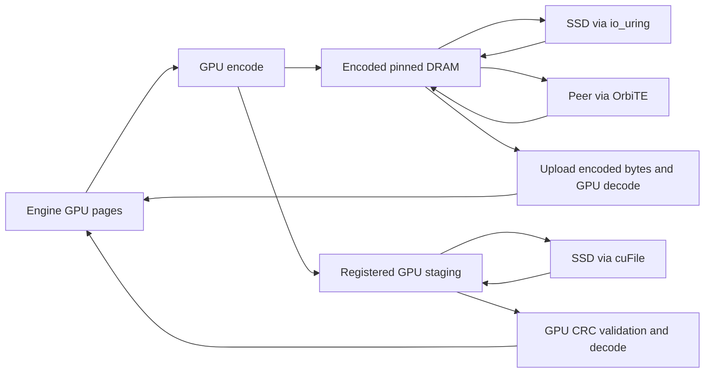

# KV precision and storage encoding

> Historical qualification below applies only to its original revisions and
> recorded backend, including TENT. OrbitKV now uses OrbiTE exclusively; all
> current GPU/RDMA/GDS and installed profiles need fresh hardware qualification.
> CPU/TCP and io_uring controls remain CI evidence.


OrbitKV can encode KV pages on the GPU before offload, keep the encoded pages in
DRAM and SSD, and transfer them unchanged between Managers. Restore uploads the
encoded bytes and reconstructs the engine's original GPU layout. Rust owns codec
selection, workspace, checksums and transfer lifetimes; Python only registers
engine tensor geometry.

## Choose a representation

| `--storage-codec` | Representation | Eligible state | Precision |
| --- | --- | --- | --- |
| `none` (default) | Original bytes | All state | Exact |
| `ans` | NVIDIA nvCOMP ANS on GPU | Byte streams, FP16/BF16, native E4M3FN | Lossless |
| `fp8` | E4M3FN | Registered FP16/BF16 attention, including MLA | Lossy |
| `turboquant-4` | 4-bit K and V plus metadata | Contiguous attention head vectors | Lossy |
| `turboquant-3` | 3-bit K and V plus metadata | Contiguous attention head vectors | Lossy |

These are **cache storage** representations. They do not change the inference
engine's HBM allocator, attention kernels or `--kv-cache-dtype`. FP8 model weights
also do not imply FP8 KV. Lossy modes are experimental and require application
quality qualification; they are not enabled by default.

```bash
orbitkv-cache-manager --pool-size 8gb \
  --storage-codec turboquant-4 --storage-codec-budget 64mb \
  --ssd-cache-path /data/orbitkv/cache.bin --ssd-cache-capacity 100gb
```

Omit the SSD arguments to use encoded DRAM only. Both the vLLM and SGLang
connectors register the required layout without a separate compression setting.
All peers sharing encoded state need the selected codec and its dependencies.
The former `--ssd-codec` and `--ssd-codec-budget` flags have been removed.

## GPU ANS

ANS uses the nvCOMP 5.3 C ABI loaded by Rust. Install NVIDIA's CUDA 13 runtime:

```bash
pip install nvidia-libnvcomp-cu13==5.3.0.16
export ORBITKV_NVCOMP_LIBRARY=/path/to/site-packages/nvidia/libnvcomp/lib64/libnvcomp.so.5
orbitkv-cache-manager --pool-size 8gb --storage-codec ans
```

System installations may expose
`libnvcomp.so.5` directly through the dynamic loader. A requested ANS policy fails
startup if this dependency is missing or has an unsupported ABI. OrbitKV does
not bundle NVIDIA's library or headers. See [NVIDIA installation instructions](https://docs.nvidia.com/cuda/nvcomp/installation.html).

Following [FlexKV's GPU ANS integration](https://github.com/taco-project/FlexKV/blob/738ddc141a198b4e20de6c5d1f0128e387f7fdb2/csrc/compression/ans/nvcomp_ans.cu),
typed 16-bit and native FP8 tensors select nvCOMP's corresponding datatype;
opaque and recurrent state use byte-stream compression. Decompression checks
both nvCOMP status and the exact output length. Incompressible pages remain raw.

## FP8 and TurboQuant

FP8 matches E4M3FN round-to-nearest, ties-to-even, including signed zero and
subnormals. Ada/Hopper and newer GPUs use FP8 conversion instructions; older
GPUs use the CUDA arithmetic implementation. A segment containing nonfinite
values or values outside [-448, 448] remains raw instead of being clipped.
If the configured GPU workspace cannot hold FP8 output, Rust selects
AVX-512F, AVX2 or scalar CPU code at runtime. AVX-512
handles 16 values per iteration, AVX2 handles eight, and scalar code completes
unaligned tails. The same lookup tables preserve identical rounding and range
rejection on every backend. This fallback saves capacity but transfers the
original width over PCIe.

TurboQuant follows [LMCache's MSE + norm-correction serde](https://github.com/LMCache/LMCache/tree/05a013b29da78cf2321b9b46ec5039dde2fb0bb0/lmcache/v1/distributed/serde/turboquant):

- K: normalize each head vector, apply deterministic random signs and an
  orthonormal Walsh-Hadamard transform, then encode Gaussian Lloyd-Max centroids.
  Restore corrects the centroid-vector norm and applies the inverse transform
  and the original FP16 norm.
- V: per-vector uniform quantization with FP16 minimum and scale.
- Head dimensions 32, 64, 128 and 256 are supported. The first and last two
  layers of each pipeline stage remain exact. MLA, recurrent/convolution
  checkpoints and unverified head layouts remain exact under this policy.

OrbitKV's versioned sign generator and segment layout are its own; encoded bytes
are not interchangeable with LMCache's serialized objects. For D=128, 4-bit K/V
use 66/68 bytes per vector versus 256 original bytes; 3-bit uses 50/52 bytes.
These are payload sizes, not an end-to-end compression or speedup guarantee.
Alignment, protected layers, raw fallback and metadata reduce total savings.

The Manager validates dtype, head dimension, stride and K/V roles, including
vLLM's packed `[block, head, token, 2 × head_dim]` layout and separate K/V tensors,
against imported tensors. Quantization never infers head layout from byte count.
Format, geometry and rotation seed participate in the v2 storage namespace.
The namespace version prevents older Managers that lack encoding metadata from
adopting compressed replicas; all Managers in a deployment should be upgraded.
Codec-enabled instances use per-layer storage, including when the adapter
requests page-first placement; this is transparent to engine page addressing.

## Ownership, storage and GDS



Each encoded segment carries a version, original length, format, stored length
and CRC32. The Manager validates checksums before cache admission or GPU decode.
A damaged SSD object becomes a miss; only that generation is invalidated, so
republication can repair it. Allocation, budget and destination errors fail the
restore without invalidating healthy SSD data. Peer transfers carry the same
metadata and verify received bytes. SSD files and indexes are ephemeral by default.
[Opt-in persistence](storage-persistence.md) verifies the complete stored extent,
including encoded metadata and padding, before the first recovered hit.

### Read-time integrity

Every sealed DRAM object has a CRC32C over its immutable raw or encoded slots.
Every SSD extent has a CRC32C established by a drained, full-extent OrbiTE
read-back before commit/publication, including zero padding. Persistence keeps
this checksum in its checksummed record; nonpersistent entries retain it in
memory. Encoded segments additionally keep their existing IEEE CRC32. These
checks detect accidental corruption, not malicious writes or a hash collision.

| Read path | Verification and failure boundary | Added work and bound |
| --- | --- | --- |
| DRAM → engine | Check at lookup and again before the Restore grant; remove the exact bad owner from residency/inventory. No engine destination is submitted on failure. | Two full CPU CRC32C scans per restore; one scan at sealing, no payload scratch |
| SSD → host | Check the actual drained host bytes before materialization/publication, then seal the new DRAM owner. Tail padding is not model state. | CPU CRC32C scan; existing read buffers, no extra payload buffer; subsequent DRAM handoff still checks |
| SSD → GPU, raw | Verify the complete immutable source through OrbiTE; derive expected CRCs for the requested layer ranges. Read directly into GPU destinations and hash the actual ranges before publishing completion. | One extra full-extent file read; CPU extent/range CRCs; existing codec CRC kernels read up to 16 MiB per launch with at most 8 KiB arena space |
| SSD → GPU, encoded | Verify the source extent; existing input-owner CRC validation precedes decode. | One extra extent read, then existing codec checks/workspace |
| Peer → engine/DRAM | Verify the retained source before issuing a grant. Grants keep it immutable through physical drain; OrbiTE's TCP/RDMA transport supplies wire integrity. Encoded receives also validate on decode. | One source-side CPU scan, no new transport staging or registration |

A mismatch is an integrity miss, never successful readiness. DRAM and host SSD
checks leave engine destinations untouched. A GPU file read may already have
written its destination: the failed Restore completion explicitly invalidates
that load, and the engine must recompute; no layer-ready or successful hit is
published. Invalidation removes only the bad generation, while existing readers,
registrations and grants remain alive until their physical receipt. Budget,
allocation and device failures fail the load without declaring healthy data
corrupt. Timeout/cancel/Unquiesced never become release receipts.

One serialized 1 MiB checksum scratch per SSD store comes from the existing
pinned-host pool. All checksum READs use OrbiTE with the operation's deadline
and intent; an uncertain receipt retains its scratch and extent. Per-copy
expectations are capped by the engine descriptor bound; GPU CRC reuses the
worker's codec owner and budget. There is no new coordinator or GPU payload
staging buffer. This conservative path adds read amplification and CPU/GPU work;
[paired CPU controls](https://github.com/OrbitInfra/OrbitKV/blob/main/benches/storage/README.md#cpu-integrity-overhead) isolate
scan/copy overhead. They do not measure serving, NVMe/GDS or GPU throughput.
Hardware profiles remain unqualified.


Encoded segments are kept only when their aligned footprint saves at least
12.5%. Oversized, unsupported, nonfinite or insufficient-budget segments use the
raw path. Source segments up to 16 MiB are encoded; larger segments remain raw.
ANS additionally requires at least 4 KiB and 8-byte aligned GPU input.

GPU encoding groups up to 256 segments into a budgeted batch. ANS uses nvCOMP's
batched API; FP8 and TurboQuant use descriptor-based CUDA launches. A worker
retains its GPU arena, including descriptors, codebooks, checksums and temporary
memory, for later batches. Output sizes and statuses are collected once per
batch. Arena growth releases the old allocation first; teardown drains GPU work
before releasing memory.

Restore validates destinations across the whole request before splitting it
into codec batches or choosing CPU fallback. Unregister waits for outstanding
work and releases retained codec and cuFile resources before acknowledging.

`--storage-codec-budget` bounds retained GPU codec workspace **per worker**,
including ANS temporary memory and output capacity; default 64 MB. Save and
restore have independent workers. Direct encoded SSD writes use an additional,
bounded writeback lane so slow writes do not block demand reads or ordinary host
publication. The SSD decoder budgets its reusable encoded input and codec scratch
together. cuFile's registered I/O staging is accounted separately. Encoded host
residency consumes `--pool-size`, and leases retain it until completion. CPU FP8
fallback uses at most one 16 MiB host reconstruction buffer per worker, plus
fixed lookup tables. Canceling requests cannot release submitted I/O or DMA early.

With cuFile selected, complete state groups that fit an encoding batch can write
their encoded GPU bytes directly to SSD. A compressed DRAM copy is retained for
hot reuse. Fragmented groups, CPU-encoded payloads and groups exceeding the batch
budget seal in DRAM and use io_uring writeback. All writes publish SSD metadata
only after successful completion; alignment padding is initialized.

Demand reads of encoded cuFile objects assemble bounded GPU inputs, validate CRC32
on GPU, and decode into engine pages without a host payload bounce. Both raw and
encoded sources may appear in one restore. A corrupt generation is hidden from
new readers immediately and reclaimed after existing extent leases drain.
Speculative preparation still reads into DRAM through io_uring. Native GDS
qualification requires a suitable host and filesystem; container compatibility
tests do not establish native GDS performance. See [GPU storage](gds.md).

## Qualification

Use a prebuilt Manager (`ORBITKV_CACHE_MANAGER_BINARY`) and run Cargo builds
separately from live Managers. The Rust GPU codec tests cover exhaustive FP8
source values, 3/4-bit K/V reconstruction and ANS exact round trips. Source-only
Python tests verify connector contracts without a GPU.

```bash
# From python/: run the same commands with ans, fp8, turboquant-4 and turboquant-3.
../.venv/vllm-release/bin/python -m pytest -m e2e \
  tests/e2e/test_vllm_e2e_correctness.py --model /path/to/Qwen3-8B \
  --max-model-len 4096 --orbitkv-pool-size 1gb --vllm-cache-tier ssd \
  --storage-codec ans --ssd-backend uring
../.venv/sglang-release/bin/python -m pytest -m e2e \
  tests/e2e/test_sglang_direct_e2e.py -k ssd --model /path/to/Qwen3-8B \
  --storage-codec ans --ssd-backend uring
```

Keep model, engine dtype, requests, capacity and concurrency identical to the
`none` control. Exact-output tests remain strict: lossy output changes are
quality findings, not grounds to weaken the exact recovery gate. Measure
quality, encoded and total bytes, encode/decode duration, TTFT and throughput.
GPU encoding can contend with inference and small segments incur submission
and synchronization overhead; compression alone is not evidence of a latency win.
See [metrics](metrics.md). The [historical codec evidence](https://github.com/OrbitInfra/OrbitKV/blob/4a36b11c680b9e82f05a663da5cb38c0dc694a9b/docs/storage-formats.md#recorded-checks) retains exact revisions, failed quality controls and limits. It does not qualify current OrbiTE GPU/installed paths.
