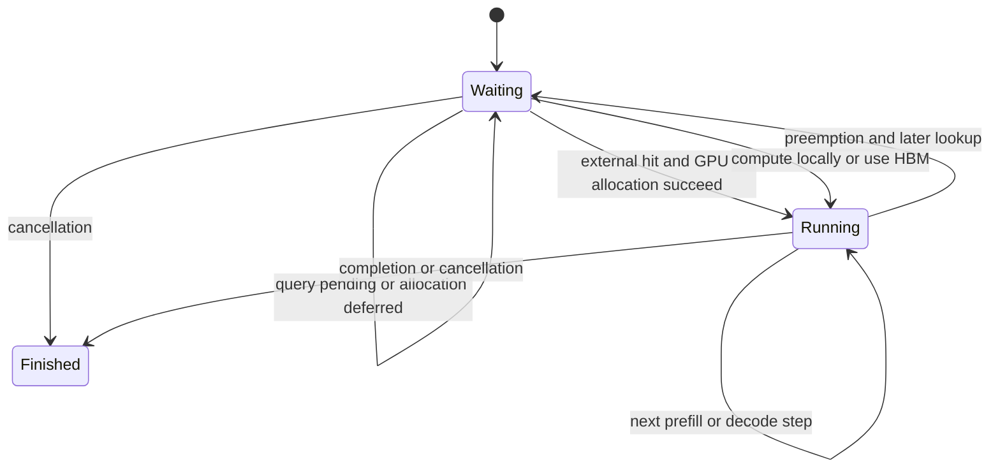
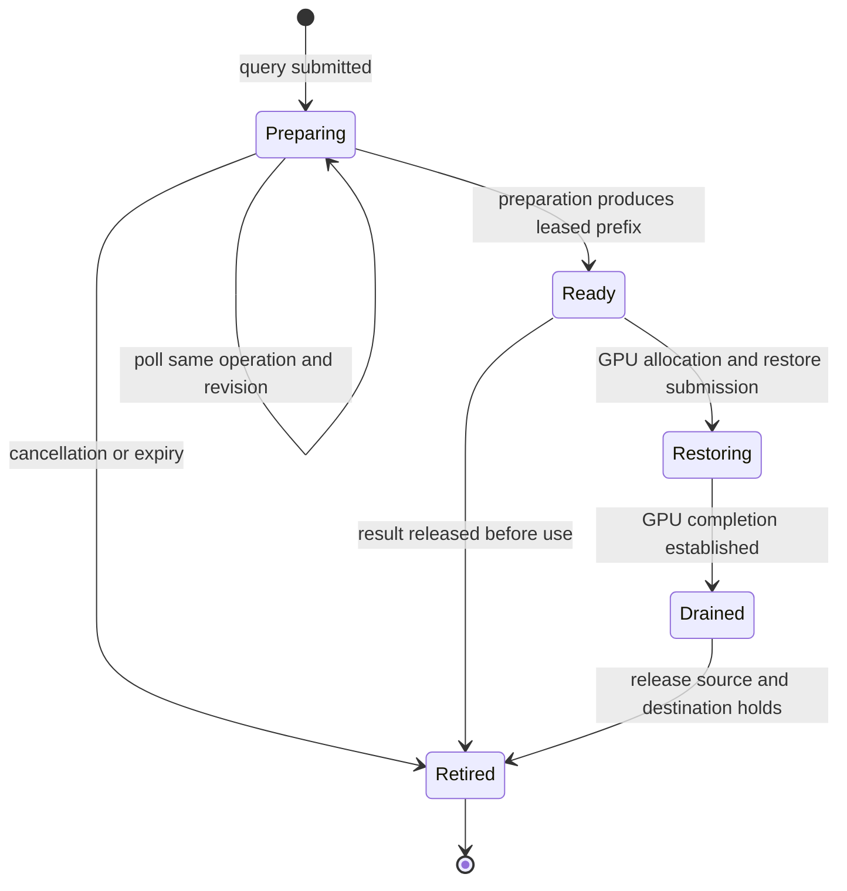

# vLLM request and cache lifetimes

This describes the vLLM 0.31.0 V1 adapter and the current Cache Manager protocol.
The engine owns request scheduling and GPU block allocation. OrbitKV owns
external preparation, ready leases and copy completion; those lifetimes do not
end just because a request is cancelled or a scheduler lookup is repeated.

The relevant code is the
[adapter scheduler](../python/orbitkv/vllm/scheduler.py),
[worker](../python/orbitkv/vllm/worker.py),
[Rust manager client](../crates/orbitkv-channel/src/cache_client.rs) and
[vLLM V1 scheduler](https://github.com/vllm-project/vllm/blob/db9527a46873454610df6dbedf79a36d6bf1a7f6/vllm/v1/core/sched/scheduler.py).

## Scheduler admission

vLLM first checks its own HBM prefix cache, then calls
`get_num_new_matched_tokens(request, num_computed_tokens)`. An unresolved query
returns `(None, False)` so the request can be retried. A ready query returns
`(hit_tokens, False)`: restoration belongs to the same forward that consumes it.

Only after `allocate_slots()` succeeds does vLLM call
`update_state_after_alloc()`. The adapter checks that the proposed load matches
the query's hash slice and leases, then creates a load intent with the allocated
GPU destinations. The selected release profile requires one attention cache
group; complete hybrid recovery remains open in [the completion plan](completion-plan.md).

`Running` is a scheduler state, not proof that the GPU copy has finished. Layer
events order the consuming forward after its restored bytes. Ordinary OrbitKV
loads do not use `WAITING_FOR_REMOTE_KVS` or a later `finished_recving` promotion;
native P/D is a separate loader. The diagram omits structured-output and
streaming-input wait states.

## Query ownership and revisions

`CacheManagerClient.query_prefetch()` uses the versioned process-channel query
API. An operation ID identifies the query, a revision identifies its current
hash/option set, and repeated lookups poll admitted work. Changed input advances
the revision. A pending result contains no usable recovery promise; a positive
ready result carries leases for the returned prefix.

Preparation and ready results consume the manager's byte budget. Repeated
scheduler calls reuse the adapter's matching probe instead of acquiring another
ready lease. A changed hash slice, a no-longer-needed result, request completion
or shutdown cancels pending interest or releases unconsumed leases. Same-host
TP query results use a common ready prefix and one lease per shard.

This is an ownership diagram, not an additional network protocol. An abandoned
preparation can finish without another client poll; completion then releases its
resources. Identical backing reads may share preparation, but separate engine
GPU destinations still require their own restores. See
[query budgets and demand planning](state-planning.md).

## Batched restoration and compute admission

After allocation, vLLM adds the request and its positive compute token count to
the current step. Subsequent ready hits, misses and HBM hits can join that step
within native token and page budgets. If a later allocation fails, vLLM stops
admission without removing requests already scheduled; their restores still run.
The unallocated request retains its query lease for a later lookup or cancellation.

Worker metadata carries every admitted load intent. One native restore batches
these requests; per-layer CUDA events fence reads, including shared HBM pages
used by another request in the same forward. The worker waits for full native
restore completion before returning transfer completion. Removing the old
global admission gate does not release a lease, GPU page or copy owner.

The [historical async-restore deadlock and admission gate](https://github.com/feichai0017/orbitkv/blob/a9befeec596bb9064d25d34f93d07fe59077809d/docs/vllm-request-state-machine.md#restore-completion-is-not-compute-admission)
describe the earlier waiting/promotion path. That gate is unnecessary for the
current synchronous scheduling contract and prevented useful batching.

## Publish, preemption and cancellation

The engine decides which computed blocks to save. The adapter retains source
pages while Publish performs D2H copies; save completion permits those holds to
be released. SSD writes proceed asynchronously and can be dropped under pressure.
A successful Publish therefore does not promise an SSD replica.

Preemption changes the request's computed prefix and block allocation. Later
lookups must match the new query evidence. Workers finish or drain copy work
that depends on an old allocation before the engine can overwrite it. Async
saves can delay block freeing through vLLM's `finished_sending` contract.

Cancellation withdraws pending query interest and releases unconsumed ready
leases. It cannot cancel submitted DMA by forgetting a handle. vLLM tracks
scheduled work before freeing cancelled requests; the worker's full native
restore wait precedes its model-runner result. Unknown completion retains the
corresponding owners and fails the affected engine. Complete physical fault
reclamation remains unqualified.

## Failure boundaries and remaining work

vLLM supports reporting invalid loaded blocks and recomputing the affected
suffix. This is only safe when the transfer has stopped touching its
allocations. OrbitKV fails the affected engine on lost restore acknowledgements,
poll failures or deadlines instead of treating uncertain DMA as cancelled.
Manager shutdown drains GPU queues before CUDA IPC mappings are released.

Current tests cover revised queries, cancellation, retained budgets, scheduler
admission and GPU recovery. They do not establish complete generation-safe page
references or hybrid recovery proofs for arbitrary models. Publish can still
retain a source indefinitely if a live manager never completes it;
the Publish watchdog reports stalled ownership; deterministic fault tests cover
restart and lost notifications. Broader concurrent fault/soak qualification remains. See
[the work queue](completion-plan.md) and [transport ownership](transport.md).
